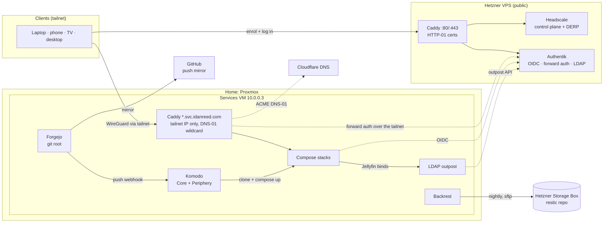

# BasicBastardSelfhosted

A declaratively managed personal homelab: **NixOS** flakes for the hosts,
**Docker Compose** stacks for the services, **Komodo** GitOps for deploys,
**Authentik** for single sign-on, **SOPS + age** for secrets, all behind
**Caddy** and reachable only over a self-hosted **Headscale** tailnet.

> **A personal project, not a product.** One operator's fleet, shared for
> reference. Everything is pinned to this fleet — real domains, a Proxmox VM at
> a fixed address, a Hetzner VPS, particular hardware — so expect to rework
> anything you lift. It was built with heavy LLM assistance (Claude Code) and
> reviewed the same way: verify before you reuse. Secrets are committed only
> as age-encrypted SOPS files; the private key never enters the repo. The
> security model fits *this* threat model (tailnet-only services, one
> operator).

## Architecture

One flake at the repo root builds three hosts:

| Host | Output | Role | Changed by |
|---|---|---|---|
| Services VM (Proxmox, `10.0.0.3`) | `.#services-vm` | the Docker host: every stack, plus Forgejo and Komodo as host units | `nrs-vm` for the OS and secrets; `git push forgejo main` for stacks |
| Headscale VPS (Hetzner) | `.#headscale-vps` | the only public host: Headscale (native) and Authentik (compose from the flake) | `nrs-vps` (`nixos-rebuild --target-host`) |
| Desktop | `.#desktop`, `homeConfigurations.idan` | workstation and admin box | `nrs`, `hms` |

- **Network.** Nothing at home is exposed. Clients join the tailnet through
  Headscale on the VPS; Caddy on the VM binds only its tailnet IP and serves
  `*.svc.idanreed.com` with one DNS-01 wildcard certificate (the public DNS
  record points at the tailnet address).
- **Identity.** Authentik is the one IdP: native OIDC for apps that support
  it, Caddy forward auth for apps that do not, and an LDAP outpost for
  Jellyfin, whose TV clients cannot follow an OIDC redirect. Headscale logs
  people in through Authentik too. idan is the one declared account; everyone
  else enrols by single-use invitation, and their devices reach only the
  services VM's `:443`, where Authentik decides app by app.
- **Deploys.** A push to Forgejo fires one webhook; Komodo's `apply` procedure
  re-reads `komodo/sync/stacks.toml` and redeploys every stack whose files
  changed. GitHub is only a push mirror.
- **Secrets.** One age key; each value stored once — per host
  (`secrets.sops.yaml`), per stack (`secrets.sops.json`) or shared by both
  servers (`secrets/shared.sops.json`). sops-nix renders every stack's env on
  the host, so the key never reaches the container that runs compose.
- **Backups.** Nightly database dumps and a VPS pull on the host, then
  Backrest (restic) to a Hetzner Storage Box, with a dead-man ping.
- **Tests.** `tests/` boots both servers as NixOS VM tests, fully offline, and
  a set of lints holds the cross-file contracts (`./tests/run.sh`).

Declarative-first is the goal, not a claim of full coverage: the steps an app
makes impossible to automate are listed, with the reason, in
[docs/for-shame.md](docs/for-shame.md).

## Docs

| Doc | For |
|---|---|
| [docs/bring-up.md](docs/bring-up.md) | building the fleet from nothing, or rebuilding both servers over it |
| [docs/deploy.md](docs/deploy.md) | day-2: the commit → switch → push loop, secrets, adding a stack or OIDC client, backups, troubleshooting |
| [docs/services.md](docs/services.md) | the inventory: every service's port, volume, auth and image, and the network |
| [docs/accounts.md](docs/accounts.md) | users, invitations, and how the admin account is admin in each app |
| [docs/for-shame.md](docs/for-shame.md) | the manual steps, and why each one is |
| [docs/decisions.md](docs/decisions.md) | standing decisions, open questions, accepted risks |
| [tests/README.md](tests/README.md) | what the test harness proves and what it cannot |
| [headscale-vps/README.md](headscale-vps/README.md) | the VPS: shape, break-glass, troubleshooting |
| [nixos-de/README.md](nixos-de/README.md) | the desktop |
| [secrets-gen/README.md](secrets-gen/README.md) | `sopsgen`: generating and rotating secrets |

## Layout

| Path | Contents |
|---|---|
| `flake.nix` | every host, the Proxmox image, the desktop's home-manager config |
| `nixos/` | the services VM: `configuration.nix`, `modules/*.nix`, the Proxmox scripts, `backup-prepare.sh` |
| `headscale-vps/` | the VPS: modules, the Authentik compose and blueprints, `deploy.sh` |
| `nixos-de/` | the desktop |
| `stacks/<name>/` | one compose stack each: `compose.yaml`, init scripts, `secrets.sops.json`, `env.nix` |
| `komodo/`, `forgejo/` | the deploy plane, run by the host (`komodo/sync/` is the stack registry) |
| `secrets/` | values both servers read |
| `secrets-gen/` | `sopsgen` and its manifest |
| `tests/` | the VM test harness and lints |
| `ssh-pubkeys.nix` | every public key the hosts authorise |
