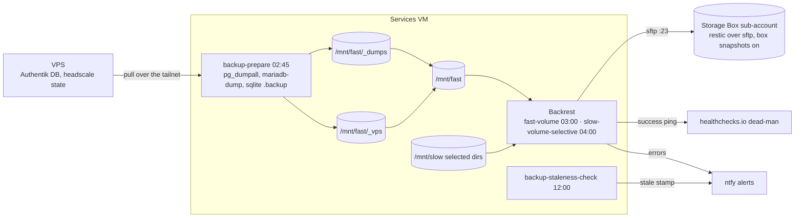

# Bring-up — the fleet from nothing

The one procedure for building this fleet from an empty account — or
rebuilding both servers over an existing fleet (§0) — in dependency order.
Every section is numbered steps, exact commands and one **Verify** line.

- Shipping a change to a fleet that exists is [deploy.md](deploy.md).
- The service inventory (ports, volumes, auth, images) is
  [services.md](services.md).
- Steps an app makes impossible to automate, and why, are
  [for-shame.md](for-shame.md).

Paths are relative to the repo root. Where this file and the code disagree,
the code wins — and the disagreement is a defect to fix here. An improvised
step on a run is a defect in this file or in the code.

---

## 0. Clean-slate redeploy

A first build skips this section — start at §1.

A clean-slate redeploy rebuilds both servers from the repo while everything
external stays: the age key, every sops value, the Cloudflare zone and token,
the Hetzner project and its primary IPv4, the Storage Box and its restic repo,
and every third-party account. §0 chooses what happens to the data, tears the
hosts down, then runs §6–§20 with the deltas in §0.6.

### 0.1 What a reset destroys

| Lives on | State | Comes back by |
|---|---|---|
| VPS disk | headscale DB, `noise_private.key`, `derp_server_private.key` | restore from `/mnt/fast/_vps/headscale/` (the nightly pull) — otherwise every node and device re-enrols |
| VPS disk | Authentik DB: `install_id`, every TOTP device (akadmin's too), sessions, the signing key | restore `_vps/authentik.sql` — otherwise idan re-enrols TOTP and every invited user's account is gone. idan, the groups and every provider are blueprints and come back regardless |
| VPS disk | Caddy's ACME certs, SSH host keys, tailscale node state | not backed up: re-issued, regenerated, re-registered |
| VM root disk | tailscale node state, the Actions runner's `.runner`, SSH host keys | re-registered (§8, §12), regenerated |
| VM `/srv` | Komodo's clones (`/srv/komodo/stacks/<name>`) | re-cloned at each stack's first deploy. The rendered envs (`/run/stack-env`) are tmpfs, rendered by every switch |
| VM `/mnt/fast` | every app's state: Forgejo (repo, users, the `komodo` bot and its token, keys, the push mirror, the webhook), Komodo's DB, Vaultwarden vaults, every app database, Syncthing's identity, hydroxide's login, Caddy's `*.svc` cert, the hand-installed Grafana plugin | restic: the `fast-volume` plan plus the `_dumps` database dumps (Appendix A) — otherwise the first-run inits create empty state |
| VM `/mnt/slow` | media, books, photos, Frigate recordings, VictoriaLogs | only the directories in the `slow-volume-selective` plan are in restic — keep the disk |

🚨 **Authentik's `sub` is per-database.** No blueprint sets `sub_mode`, so a
user's OIDC subject is a hash of their id and the database's random
`install_id`. A fresh Authentik in front of kept or restored app data breaks
every app that links accounts by `sub` (BookStack, Immich, Vaultwarden SSO,
Paperless, Tandoor, Ghostfolio, Dawarich) and makes headscale mint a duplicate
`idan`. **Whenever any app data survives, Authentik's database must too.**

Pull-class secrets minted *inside* the fleet die with it and are re-minted at
their section: both `TAILSCALE_AUTH_KEY`s (§8), `FORGEJO_RUNNER_TOKEN` (§12),
and — when Forgejo's data is new — `KOMODO_GIT_TOKEN` and the webhook (§11),
`RENOVATE_TOKEN` (§12), the `GIT_SYNC_REMOTE` PAT (§17) and the GitHub
push-mirror PAT (§11). A new Firefly database needs a new
`FIREFLY_III_ACCESS_TOKEN`; a new hydroxide volume a new
`PROTON_BRIDGE_PASSWORD`. Every other sops value survives.

### 0.2 Choose a mode

| | A — side-by-side rehearsal | B — in-place cutover |
|---|---|---|
| Hosts | a new VMID (`111`) and a new Hetzner server carrying the same primary IPv4 | VM 110 re-imaged; the same Hetzner server reinstalled |
| Data | none — every first-run path runs on empty disks | kept: the data disks re-attached (**B1**), or restored from restic onto fresh disks (**B2**) |
| VPS state | fresh: new tailnet, new TOTP enrolments | restored: Authentik (required, §0.1), headscale, node state, certs |
| Rollback | power the new hosts off and the old ones on | the parked disks (§0.5) and the pinned restic snapshot |
| Repeatable | at most 4 runs per 7 days (Let's Encrypt, §0.3) | once |

Rehearse in mode A until a run needs no improvisation, then cut over with mode
B. Only one fleet runs at a time: both VMs use `10.0.0.3`, and both servers
answer on the same IPv4. A mixed run is fine — e.g. B for the VM only, with the
live VPS untouched.

**A VM-only rehearsal** keeps the live VPS and its tailnet: copy 110's
`/var/lib/tailscale` and SSH host keys to tmpfs before shutting it down, and
put them on 111 after its first boot, before the reboot that brings its
secrets (§9.2). 111 then joins as the same node, keeps `100.64.0.2`, and needs
no preauthkey; §8, §13 and §14 have nothing to do. Restore only once
`systemctl is-active cloud-final` prints `active` — cloud-init regenerates the
host keys when it writes the age key and overwrites an earlier copy. Check by
fingerprint: `ssh-keygen -lf /etc/ssh/ssh_host_ed25519_key.pub`.

**A rehearsal runs from a branch**, pushed as the rehearsal Forgejo's `main`
(`git push forgejo <branch>:main`); the desktop's `main` and the old fleet's
Forgejo stay on what the rollback runs. Everything minted against the
rehearsal Forgejo (`KOMODO_GIT_TOKEN`, the CI tokens) is committed on that
branch only. On that branch, **remove `backrest`'s `[[stack]]` block** from
`komodo/sync/stacks.toml` before the first Test Delivery: `apply` deploys every
registered stack, and a rehearsal's Backrest would back the empty fleet up
into the production repo, where retention ages the real snapshots out. (The
`komodo-sync-coverage` lint fails on that commit; it never reaches `main`.)

### 0.3 Pre-flight, on the live fleet

1. **Gates.**
   - The §5 artifact exists. The reset wipes two of the age key's three
     copies, leaving the desktop holding the only one.
   - The tree is clean; `./tests/run.sh deploy-check` and `nix flake check`
     are green; `sopsgen apply --dry-run` lists nothing missing (it cannot see
     `KOMODO_GIT_TOKEN`); `git push forgejo main` has nothing to send. The
     desktop's checkout is what seeds the new Forgejo.
   - Let's Encrypt budget: a fresh run issues three certificates
     (`headscale.`, `auth.`, `*.svc.idanreed.com`), each limited to 5 per 7
     days.
2. **Save what §9 and §13 compare against:**

   ```bash
   ssh proxmox 'qm config 110' > ~/vm110.conf
   ssh vps 'sudo headscale nodes list' > ~/headscale-nodes.txt
   ```

3. **Back up now.** On the VM, `sudo systemctl start backup-prepare` (the
   dumps and the VPS pull into `/mnt/fast/_vps`), then Backrest → each plan →
   Backup Now. Note both **snapshot IDs**: after a reset the rebuilt host's own
   03:00 run snapshots whatever it has, so restore by ID, never `latest`.
4. **Mode B: copy the state each new host needs** into tmpfs on the desktop,
   then **stop the VM's `backup-prepare.timer`** until the restore verifies —
   its 02:45 pull would overwrite `/mnt/fast/_vps` with the new, empty VPS's
   state. The copy is plaintext key material: `shred` it once the cutover
   verifies. `ssh -n` matters from a script — without it `ssh … | tar -x`
   hangs on stdin:

   ```bash
   st=$XDG_RUNTIME_DIR/reset-state; mkdir -p -m700 $st/vps $st/vm
   ssh -n services-vm 'sudo tar -C /mnt/fast/_vps -cf - .' | tar -C $st/vps -xf -
   for h in vps services-vm; do
     d=$([ $h = vps ] && echo vps || echo vm)
     ssh -n $h 'sudo tar -C / -cf - var/lib/tailscale etc/ssh/ssh_host_ed25519_key etc/ssh/ssh_host_ed25519_key.pub etc/ssh/ssh_host_rsa_key etc/ssh/ssh_host_rsa_key.pub' \
       | tar -C $st/$d -xf -
   done
   ssh -n vps 'sudo tar -C / -cf - var/lib/caddy' | tar -C $st/vps -xf -
   ssh -n services-vm 'sudo systemctl stop backup-prepare.timer'
   ```

   Right before the VPS wipe, freeze it (`sudo systemctl stop authentik
   headscale`) and keep a raw tar of `/srv/authentik/pgdata` and
   `/var/lib/headscale` beside the copy as a fallback.
5. **Pause the healthchecks.io check** — the dead-man stops pinging meanwhile.
6. **Stop VM 110 cleanly** (the install scripts' `qm stop` is a hard
   power-off). Mode A also keeps it from starting beside the rehearsal:

   ```bash
   ssh proxmox 'qm set 110 --onboot 0 && qm shutdown 110'   # mode A
   ssh proxmox 'qm shutdown 110'                            # mode B
   ```

   `qm shutdown` asks the guest agent. If it times out, shut down from inside:
   `ssh idan@10.0.0.3 sudo systemctl poweroff`.

### 0.4 The VPS

**Mode A.** Hetzner console: power the old server off, then Primary IPs →
unassign its IPv4. Create the new server as §7 step 1 with **that primary
IPv4** — DNS stays untouched. Continue at §7 step 4.

**Mode B.** Reinstall over the running NixOS with `./deploy.sh idan@<VPS_IP>`
(disko wipes the disk). No rescue mode: root login is off, so nixos-anywhere
kexecs through `idan`'s passwordless sudo, and NixOS has no kernel lockdown. A
raw IP matches no ssh Host block, so the key goes in a private agent:

```bash
cd headscale-vps
echo y | ssh-agent bash -c 'ssh-add /run/secrets/ssh/vps && ./deploy.sh idan@<VPS_IP>'
```

Restore the state at once — before any client reaches the empty headscale and
before anyone logs in to Authentik. The fresh install has a new host key until
the restore puts the old one back, so these first connections skip host-key
checking (`-o StrictHostKeyChecking=no -o UserKnownHostsFile=/dev/null -i
/run/secrets/ssh/vps`):

```bash
scp -r $XDG_RUNTIME_DIR/reset-state/vps idan@<VPS_IP>:/tmp/reset-state
ssh idan@<VPS_IP>
sudo systemctl stop headscale tailscaled caddy
sudo rsync -a --delete /tmp/reset-state/headscale/ /var/lib/headscale/   # db.sqlite + both private keys
sudo rsync -a /tmp/reset-state/var/lib/tailscale/ /var/lib/tailscale/
sudo rsync -a /tmp/reset-state/var/lib/caddy/ /var/lib/caddy/
sudo install -m600 /tmp/reset-state/etc/ssh/ssh_host_*_key -t /etc/ssh/
sudo install -m644 /tmp/reset-state/etc/ssh/ssh_host_*_key.pub -t /etc/ssh/
sudo chown -R headscale:headscale /var/lib/headscale
sudo chown -R root:root /var/lib/tailscale
sudo chown -R caddy:caddy /var/lib/caddy
sudo systemctl start headscale tailscaled caddy && sudo systemctl restart sshd
# first boot met the empty headscale and hit the start limit:
sudo systemctl reset-failed tailscale-autoconnect && sudo systemctl start tailscale-autoconnect
```

The host presents its old SSH host key again; drop any install-time entry
(`ssh-keygen -R <VPS_IP>`).

Then Authentik's database, into a **virgin** cluster (`authentik.service`
initialised one at first boot):

```bash
C=$(systemctl cat authentik | sed -n 's/^ExecStart=.* -f \([^ ]*\) -p .*/\1/p')   # the store-path compose
sudo systemctl stop authentik
sudo mv /srv/authentik/pgdata /srv/authentik/pgdata.fresh-install
sudo systemd-tmpfiles --create                  # an empty pgdata, 70:70 0700
sudo bash -c "set -a; . /run/secrets/rendered/authentik.env; set +a; \
  docker compose -f $C -p authentik up -d --wait postgresql"
docker exec -i authentik_db psql -U authentik -d postgres < /tmp/reset-state/authentik.sql
#   exactly two errors are expected: role "authentik" and database "authentik" already exist
sudo systemctl start authentik
sudo rm -rf /tmp/reset-state
```

Delete `pgdata.fresh-install` once a login verifies. The proof that identity
survived is an SSO login landing on an existing account — BookStack's is the
sharpest test, since it links by `sub`. Until the tailnet is back, Alloy logs
"error sending batch" and recovers on its own.

Last, on the VM: `sudo systemctl start backup-prepare` (the pull against the
restored VPS must succeed), then `sudo systemctl start backup-prepare.timer`.

### 0.5 The services VM

🚨 **Never let a data disk belong to the VMID being restored.** `qmrestore`
over an existing VM frees every disk the image contains, detaches the rest as
`unusedN` **and deletes their snapshots** (the same on PVE 7.4 and 9). A
detached disk is one "Remove" away from gone, and the re-imaged VM boots
without it into emergency mode.

**Mode A** — a new VMID; VM 110 and its disks are never touched:

```bash
cd nixos                       # on the Proxmox host, image copied in (§9.2)
./rebuild_os_proxmox.sh 111
# §9: the qm set line with 111, then diff `qm config 111` against ~/vm110.conf
# §9.1 with 111 in place of 110. The slow disk can be small: it starts empty.
./build_proxmox.sh 111
```

**Mode B** — park the data disks on a holder VMID, re-image, bring them back:

```bash
cd nixos                       # on the Proxmox host, image copied in (§9.2)
qm create 9110 --name vm110-parked-disks --memory 128 --protection 1   # never started;
                               #   protection blocks destroy and disk removal, not moves
for d in scsi1 scsi2 scsi3; do qm disk move 110 $d --target-vmid 9110 --target-disk $d; done
qm config 110                  # only virtio0 and the cloud-init drive left
./rebuild_os_proxmox.sh 110
# §9: the qm set line, then diff `qm config 110` against ~/vm110.conf

# B1 — keep the data: all three disks go back
for d in scsi1 scsi2 scsi3; do qm disk move 9110 $d --target-vmid 110 --target-disk $d; done
# B2 — restore from restic: only the slow disk goes back; create fresh state
#   and fast disks per §9.1, and keep 9110 until the restore verifies
qm disk move 9110 scsi3 --target-vmid 110 --target-disk scsi3

./build_proxmox.sh 110
```

Snapshot the parked zvols too (`zfs snapshot <pool>/vm-9110-disk-N@parked`)
if the pool has room. Destroying 9110 (`qm set 9110 --protection 0`, then `qm
destroy 9110`) is the last step of a verified cutover, not part of it.

After the first boot, once `systemctl is-active cloud-final` prints `active`,
put the node identity back before the VM joins the tailnet — it keeps
`100.64.0.2` and needs no preauthkey:

```bash
scp -r $XDG_RUNTIME_DIR/reset-state/vm idan@10.0.0.3:/tmp/reset-state
ssh idan@10.0.0.3 'sudo systemctl stop tailscaled \
  && sudo rsync -a /tmp/reset-state/var/lib/tailscale/ /var/lib/tailscale/ \
  && sudo chown -R root:root /var/lib/tailscale \
  && sudo install -m600 /tmp/reset-state/etc/ssh/ssh_host_*_key -t /etc/ssh/ \
  && sudo install -m644 /tmp/reset-state/etc/ssh/ssh_host_*_key.pub -t /etc/ssh/ \
  && sudo systemctl start tailscaled && sudo systemctl restart sshd \
  && sudo rm -rf /tmp/reset-state'
ssh-keygen -R 10.0.0.3          # the old host key is back; drop the install-time one
```

**Carrying only some services' data** onto fresh disks (B2 without a full
restore): stop the plane's containers first — `docker stop forgejo komodo
komodo_periphery komodo_ferretdb komodo_db` (the Forgejo unit has no stop
hook, so `systemctl stop` leaves the container up) — copy the service's
`/mnt/fast/<service>` tree in with ownership preserved, then
`sudo systemctl restart forgejo bootstrap-komodo`.

B2 restores `/mnt/fast` per Appendix A after §9.3's switch and **before the
first `apply`**. Until the restore verifies, push nothing, send no Test
Delivery, and keep `backup-prepare.timer` stopped.

### 0.6 Then §6–§20, with these deltas

| § | Mode A | Mode B |
|---|---|---|
| §2–§4 | done: accounts, the age key and every sops value exist. Generate nothing; `rotate` nothing | same |
| §5 | a gate (§0.3) | same |
| §6 | nothing — the IPv4 moved with the server | nothing |
| §7 | from step 4, on the new server | `./deploy.sh idan@<VPS_IP>`, then the restore in §0.4 |
| §8 | as written: an empty database, the `bootstrap` user, a key both hosts use within 24 h, the VPS before the VM | nothing when both nodes' state was restored. Otherwise mint under `idan`, `headscale nodes delete` the stale node first, and compare the new address with `~/headscale-nodes.txt` |
| §9 | VMID 111 (§0.5); §9.2 reboot and §9.3 as written | §0.5; §9.2 reboot and §9.3 as written |
| §10 | as written — Forgejo and Komodo came up with §9.3 | same; B2 restores per Appendix A first |
| §11 | all seven steps; the token is committed on the rehearsal branch only | B1: nothing — Forgejo came back with the disks. Check `komodo-sync-bootstrap` registered every stack, deploy ntfy, send a Test Delivery. A fresh Forgejo: all seven steps |
| §12 | a new runner token and Renovate PAT, both on the rehearsal branch | a new runner token — `.runner` lived on the root disk |
| §13 | as written; `TAILNET_IP` is unchanged when the VPS joined first | nothing if the VM kept `100.64.0.2` |
| §14 | as written. akadmin's new TOTP seed replaces the old one in the §5 artifact. The desktop re-enrols (`sudo tailscale up --login-server=https://headscale.idanreed.com --force-reauth`) before `nrs-vps` can reach `vps` | nothing — Authentik and headscale were restored |
| §15 | idan comes back from the blueprint; invited users need a new invitation | nothing |
| §16 | **skip** — `backrest` is off the rehearsal branch | B1: nothing. B2: nothing until the restore verifies |
| §17 | ntfy by hand, then the Test Delivery deploys the rest | the same, once a B2 restore verifies |
| §18 | nothing to order (see §18) | nothing |
| §19 | nothing; the desktop stays | nothing |
| §20 | as written | as written |

**Ending a rehearsal (mode A).**

1. Hetzner: power the rehearsal server off, unassign the primary IPv4, assign
   it back to the old server, power that on. Delete the rehearsal server.
2. Proxmox: `qm shutdown 111`, then `qm set 110 --onboot 1 && qm start 110`;
   `qm destroy 111 --purge` once nothing in it is needed.
3. The desktop re-enrols against the old headscale with the same `tailscale up
   --force-reauth`; so may any other device that met the rehearsal headscale.
4. Resume the healthchecks.io check.

---

## 1. Order of operations

```
§0  clean-slate redeploy        resetting an existing fleet: read it first,
                                then work §6–§20 with its deltas
§2  prerequisites, accounts
§3  age key                     everything else decrypts with it
§4  secret inventory + sopsgen  fill what can exist before any host does
§5  offline recovery artifact   now, not last
§6  domain, DNS zone, CF token  the VPS's ACME needs the A records first
§7  headscale VPS               control plane + identity provider
§8  tailnet identity            the bootstrap user + preauthkeys
§9  services VM                 image, disks, key, first switch
§10 the deploy plane            Forgejo + Komodo, up with §9.3's switch
§11 git root, bot token, webhook, first apply (ntfy first)
§12 CI: Actions runner + Renovate   credentials here, registration after §13
§13 Caddy + Cloudflare TLS      needs the VM's tailnet IP
§14 Authentik: OIDC, forward auth, LDAP, the real idan
§15 accounts
§16 Storage Box + Backrest
§17 per-stack first deploy
§18 VPS log shipping            the one reversed-order change
§19 desktop
§20 verification sweep
```

Two ordering traps, both silent when violated:

- **OIDC, forward auth and LDAP: the VPS goes FIRST.** An app that turns OIDC
  on before its Authentik provider exists is a lockout, not a login page:
  `nrs-vps`, then `nrs-vm`, then the push.
- **VPS log shipping: the VPS goes LAST.** Alloy on the VPS pushes *to* a
  services-VM vhost, so the vhost must exist first (§18).

---

## 2. Prerequisites

1. A Linux (or WSL) machine with nix and flakes, and this repo checked out.
   One flake at the root builds every host (`.#services-vm`,
   `.#headscale-vps`, `.#proxmox-image`, `.#desktop`).
2. Accounts:

   | Account | For | Needed at |
   |---|---|---|
   | Cloudflare | registrar + DNS zone; the DNS-01 token for `*.svc` | §6 |
   | Hetzner Cloud | the VPS (≥4 GB RAM) | §7 |
   | GitHub | builds and publishes the Caddy image to GHCR (`.github/workflows/build-caddy.yml`); the push mirror | §11, §13 |
   | Hetzner Storage Box | the restic repository | §16 |
   | Healthchecks.io | the backup dead-man switch | §16 |
   | Proton | alert mail (ntfy SMTP) and the `proton` stack | §17 |
   | A WireGuard VPN provider with port forwarding | gluetun egress for the download path | §17 |
   | Anna's Archive (donator) | the books stack's download source | §17 |
   | SimpleFIN Bridge | Firefly's bank sync | §17 |

   Tailscale-the-SaaS is deliberately not a dependency: `derp.urls = [ ]` in
   `headscale-vps/modules/headscale.nix` keeps the nixpkgs default from
   fetching Tailscale's DERP map; the embedded DERP server is the only relay.

**Verify:** `nix flake metadata .` evaluates at the repo root.

---

## 3. The age key

One age key encrypts every secret on every host. It is the only secret not in
the repo.

1. Generate it at the **repo root** (gitignored). Both install scripts read
   `../sops_age_key.txt` relative to their own directory:

   ```bash
   age-keygen -o sops_age_key.txt
   ```

2. Put the **public** half into every production creation rule in `.sops.yaml`.
   The committed recipient is
   `age1m69ep7lcjgzvdjc49gcaqszmw60u5xj4wfmsd7qcwayh47538shq3wa4xf`. Changing
   it orphans every encrypted value — only on a true from-zero start, and then
   re-encrypt everything.
3. Delivery per host is scripted; the key never lives in the workspace
   long-term:

   | Host | Path | Delivered by |
   |---|---|---|
   | services VM | `/var/lib/sops-nix/sops_age_key.txt` (0600, dir 0700) | cloud-init, `nixos/build_proxmox.sh` (reads `../sops_age_key.txt` in a repo checkout **on the Proxmox host**) |
   | VPS | same | `nixos-anywhere --extra-files`, `headscale-vps/deploy.sh` (reads `../sops_age_key.txt`, else `sudo cat`s the local copy) |
   | desktop | same | copied from the install USB (§19) |

   `build_proxmox.sh` also leaves the key in `/var/lib/vz/snippets/nixos-userdata.yaml`
   (0600) and the VM's cloud-init drive while `cicustom` points at it. Delete
   the repo-root copy on the Proxmox host once the VM has booted twice.
4. Once the desktop exists, edits go through the sudo-gated wrappers in
   `nixos-de/home.nix`: `sopsedit <file>`, `sopseditnvim <file>`, and
   `sops -e -i <file>` for a new plaintext file (public key only).

**Verify:** `grep -c age1m69ep .sops.yaml` prints the number of production
rules; `sops -d headscale-vps/secrets.sops.yaml >/dev/null` succeeds with the
key in `SOPS_AGE_KEY`.

---

## 4. Secret inventory and `sopsgen apply`

A value is stored **once**. A stack's own values live in
`stacks/<name>/secrets.sops.json` (Komodo's and Forgejo's in `komodo/` and
`forgejo/`); values two places need — OIDC client secrets, idan's password,
the vlogs token, the LDAP secrets — live once in `secrets/shared.sops.json`,
which both hosts read (`secrets/shared.nix`); a value built from others is
never stored but built by the stack's `env.nix`. How these reach a container
is [deploy.md](deploy.md#secrets).

`secrets-gen/manifest.yaml` manages every generated, derived, pulled and
configured value; `sopsgen list` prints them. Every entry has a class:

| Class | Meaning |
|---|---|
| `generate` | drawn by `sopsgen apply` |
| `derived` | stored as a transform of the draw (ed25519 keypairs, password hashes) |
| `pull` | minted somewhere else — generation is refused, you paste it |
| `config` | an operator fact, not a secret; reported, never generated |

Run this **before any host exists**:

```bash
sopsgen apply --dry-run              # keyless, read-only; read the plan
sopsgen apply                        # one sudo for the age key; draws every generate/derived value
sopsedit secrets/shared.sops.json    # IDAN_INITIAL_PASSWORD (§15)
sopsgen apply                        # derives idan's stored copies (Backrest, qBittorrent hashes)
sopsedit stacks/media/secrets.sops.json   # media/config: QBIT_WEBUI_USER, JELLYFIN_ADMIN_USER,
                                          #   SEERR_ADMIN_EMAIL, the VPN facts
sopsgen sort                         # normalise key order in the yaml files
./tests/run.sh deploy-check          # sops-declared + the operator to-do report
```

`apply` only fills missing or `changeme*` values and refuses on diverged
twins; `sopsgen rotate <name>` changes one. It decides "placeholder" by
prefix, so a value that embeds a placeholder mid-string (`idan:changeme…`)
reads as real — check those by hand with `sopsgen view <file>`.

🚨 **Never regenerate a secrets file from its template** (`.example`,
`secrets.example.env`). sops has no append-without-decrypt, so that destroys
real key material. The base64 `data:` blob's length gives the exact plaintext
byte count: a real ed25519 key is ~400 bytes encrypted, a `changeme_`
placeholder ~40.

### The files

| File | Format | Holds |
|---|---|---|
| `nixos/secrets.sops.yaml` | yaml | `TAILSCALE_AUTH_KEY` (pull, §8) · `BACKUP_VPS_SSH_KEY`, `BACKUP_STORAGEBOX_SSH_KEY` (derived) · `RENOVATE_TOKEN`, `FORGEJO_RUNNER_TOKEN` (pull, §12) |
| `headscale-vps/secrets.sops.yaml` | yaml | `TAILSCALE_AUTH_KEY` (pull, §8) · Authentik's `PG_PASS`, `AUTHENTIK_SECRET_KEY`, `AUTHENTIK_BOOTSTRAP_PASSWORD`, `AUTHENTIK_BOOTSTRAP_TOKEN` · `HEADSCALE_OIDC_CLIENT_SECRET` |
| `secrets/shared.sops.json` | json | read by **both** hosts: every app's OIDC client secret (Authentik's blueprints on the VPS, each app's `env.nix` on the VM) · `IDAN_INITIAL_PASSWORD` · `VLOGS_INGEST_TOKEN` (§18) · `JELLYFIN_LDAP_BIND_PASSWORD`, `LDAP_OUTPOST_TOKEN` (§14) |
| `nixos-de/secrets.sops.yaml` | yaml | `ssh/<name>` per desktop identity (derived) · `workvpn/*` (config) |
| `komodo/secrets.sops.json` | json | `KOMODO_INIT_ADMIN_{USERNAME,PASSWORD}`, `KOMODO_JWT_SECRET`, `KOMODO_WEBHOOK_SECRET`, `KOMODO_DATABASE_PASSWORD` (hex — it rides a `postgres://` URL) · `KOMODO_GIT_TOKEN` (pull, §11; in no manifest entry, so neither `sopsgen` nor `deploy-check` reports it) |
| `forgejo/secrets.sops.json` | json | nothing stored: its OIDC secret is built from the shared file (`forgejo/env.nix`) |
| `stacks/caddy/secrets.sops.json` | json | `TAILNET_IP` (config) · `CLOUDFLARE_API_TOKEN` (pull). `VLOGS_INGEST_TOKEN` is built |
| `stacks/backrest/secrets.sops.json` | json | `RESTIC_PASSWORD` · `BACKREST_ADMIN_PASSWORD_BCRYPT` (base64 **of** the bcrypt) · `DEADMAN_URL` (pull) |
| `stacks/firefly/secrets.sops.json` | json | `PASSPORT_PRIVATE_KEY`/`PASSPORT_PUBLIC_KEY` are one derived RSA entry stored as single-line PEMs with literal `\n`, `freeze: true` — rotating them invalidates every issued token |
| `stacks/<name>/secrets.sops.json` | json | the rest of each stack's stored values; a stack with no secrets has no file |
| `secrets-recovery.sops.yaml` | yaml | plaintext escrow of values whose stored form is a hash (Vaultwarden's admin token, Wealthfolio's password, older entries). **Same recipient** — no protection against age-key loss (§5) |

Each JSON file's key inventory is its `secrets.example.env`; the
`stack-env-drift` lint holds the example, the real file and
`tests/fixtures/stacks/<name>.sops.json` to the same set.

### Pull-class values, and where each is minted

| Value | Minted at | § |
|---|---|---|
| `TAILSCALE_AUTH_KEY` (both hosts) | `headscale preauthkeys create` on the VPS | §8 |
| `caddy/CLOUDFLARE_API_TOKEN` | Cloudflare dashboard, `Zone:DNS:Edit` on the zone only | §6 |
| `FORGEJO_RUNNER_TOKEN` | Forgejo → Site Administration → Actions → Runners | §12 |
| `RENOVATE_TOKEN` | Forgejo → Settings → Applications (`read:user`, `write:issue`, `write:repository`) | §12 |
| `komodo/KOMODO_GIT_TOKEN` | Forgejo, as the `komodo` bot: a `read:repository` token | §11 |
| `backrest/DEADMAN_URL` | a healthchecks.io check | §16 |
| `ntfy/NTFY_SMTP_SENDER_PASS` | a Proton SMTP submission token (or leave all three SMTP keys empty: phone push only) | §17 |
| `media/vpn` (`WIREGUARD_*`, `VPN_ENDPOINT_*`, `FIREWALL_VPN_INPUT_PORTS`, …) | the VPN provider's WireGuard config and forwarded port | §17 |
| `books/AA_DONATOR_KEY` | Anna's Archive account | §17 |
| `firefly/SIMPLEFIN_TOKEN` | a SimpleFIN Bridge claim URL (one-shot) | §17 |
| `firefly/FIREFLY_III_ACCESS_TOKEN` | Firefly UI → Profile → OAuth, after first login | §17 |
| `silverbullet/GIT_SYNC_REMOTE` | a private Forgejo repo + a `write:repository` PAT | §17 |
| `proton/PROTON_ACCOUNT`, `PROTON_BRIDGE_PASSWORD` | `docker exec -it hydroxide /app/hydroxide auth <account>` | §17 |
| `automation/FRIGATE_REOLINK_PASSWORD` | set on the cameras in the Reolink app (letters and digits only) | §17 |

Config-class values, set by hand with `sopsedit`: `caddy/TAILNET_IP`,
`logging/GF_SECURITY_ADMIN_USER`, `automation/FRIGATE_REOLINK_USER`,
`books/AA_MIRROR_URLS` (the *required* half of the Anna's Archive pair),
`beszel/config` (`USER_EMAIL`, `FILESYSTEM` — before Beszel's first boot),
`media/config`, `de/workvpn`.

**Verify:** `./tests/run.sh deploy-check` is green, and its operator-readiness
tail lists only values deliberately left for later.

---

## 5. Offline recovery artifact

Do this before the first host exists; it is the largest unmitigated risk in
the design and the step that gets skipped when left for last.

1. Write down, off this infrastructure (paper, or a USB in a drawer — **not**
   only in Vaultwarden, whose backup is encrypted with exactly these):
   - the age private key,
   - `RESTIC_PASSWORD` (`stacks/backrest/secrets.sops.json`),
   - the Storage Box sub-account name and password,
   - the Authentik `akadmin` TOTP seed (once §14 mints it),
   - the plaintexts in `secrets-recovery.sops.yaml`.
2. `secrets-recovery.sops.yaml` is encrypted to the same recipient: a
   convenience, not a second failure domain.
3. `secrets-gen/sops-to-bitwarden` decrypts every sops value into a Bitwarden
   JSON export for a password manager **off** this infrastructure. Its output
   is plaintext — `shred -u` it once imported.

**Verify:** someone with no access to any host could decrypt one
`secrets.sops.json` from the artifact alone.

---

## 6. Domain, DNS zone, Cloudflare token

1. `idanreed.com` on Cloudflare (registrar and DNS — the DNS-01 wildcard needs
   Cloudflare's nameservers anyway).
2. Records, all **DNS-only (grey cloud)** — HTTP-01 and DERP need the origin:

   | Record | Type | Value | When |
   |---|---|---|---|
   | `headscale.idanreed.com` | A | VPS public IP | before §7 |
   | `auth.idanreed.com` | A | VPS public IP | before §7 |
   | `*.svc.idanreed.com` | A | the services VM's **tailnet** IP | §13 |
   | `tailnet.idanreed.com`, `*.tailnet.…` | — | **must not exist publicly** | never |

   Publishing a CGNAT address is deliberate: meaningless off the tailnet, no
   split-horizon resolver, and DNS-01 still works. `tailnet.idanreed.com` is
   the MagicDNS base domain; headscale refuses to start if `server_url`'s host
   is inside it.
3. Mint the API token, **`Zone:DNS:Edit` on `idanreed.com` only** (it goes in
   at §13). Nothing monitors its expiry: a revoked token kills renewal
   silently 90 days later.

**Verify:** `dig +short headscale.idanreed.com auth.idanreed.com` prints the
VPS IP twice; `dig +short tailnet.idanreed.com` prints nothing.

---

## 7. Headscale VPS

1. Hetzner Cloud console: location fsn1/nbg1/hel1, image **Ubuntu 22.04**
   (wiped minutes later), the **`vps` SSH public key** from `ssh-pubkeys.nix`,
   user-data **empty**, size **≥4 GB RAM** (Authentik's floor; CX23 is the
   cheapest that qualifies).
2. Confirm §6's two A records resolve.
3. Fill the VPS secrets if §4 has not: `sopsedit headscale-vps/secrets.sops.yaml`.
   `TAILSCALE_AUTH_KEY` stays `changeme` until §8.
4. **Boot Hetzner rescue mode first.** The stock Ubuntu image enforces kernel
   lockdown and cannot kexec the NixOS installer (`kexec_file_load failed`).
   Console → the server → Rescue → enable + power cycle (linux64, the `vps`
   key), wait ~30 s, `ssh-keygen -R <IP>`, then `ssh root@<IP> true` once to
   accept the rescue host key — `deploy.sh`'s preflight runs `BatchMode=yes`
   and reports an unknown key only as "Cannot SSH to root@<IP>".
5. Install, **as yourself, not under sudo** (the script sudo-reads only the
   age key):

   ```bash
   ssh-add /run/secrets/ssh/vps      # BatchMode + a raw IP: the agent must hold the key
   cd headscale-vps
   ./deploy.sh <VPS_IP>              # DESTRUCTIVE: disko wipes and installs .#headscale-vps
   ```

6. `ssh-keygen -R <IP>` again and log in as **`idan`** — root login is off.

**Secrets needed:** `headscale-vps/secrets.sops.yaml` (minus
`TAILSCALE_AUTH_KEY`) and `secrets/shared.sops.json` (Authentik's blueprints
read the OIDC client secrets and idan's password from it).

**Verify:**

```bash
ssh idan@<VPS_IP> 'sudo systemctl is-active headscale authentik caddy; docker ps --format "{{.Names}}"'
curl -sI https://headscale.idanreed.com/health
curl -sI https://auth.idanreed.com/-/health/live/
```

Caddy here is nixpkgs-native, HTTP-01, the sole listener on 80/443; the
firewall allows 22/80/443 TCP and 3478 UDP (STUN); fail2ban jails `sshd` and
`authentik`. Config-only updates from the repo root:
`nixos-rebuild switch --flake .#headscale-vps --target-host idan@<VPS_IP> --use-remote-sudo`
— `nrs-vps` once the desktop is on the tailnet.

---

## 8. Tailnet identity

The first headscale user is a throwaway **`bootstrap`**, never `idan`. The real
`idan` is created by the first OIDC login (§14); a bootstrap user also called
`idan` would make that login mint a *second* `idan`, the `idan@` in
`policy.hujson` would resolve to neither, and every node would lose access.

1. On the VPS:

   ```bash
   sudo headscale users create bootstrap
   sudo headscale users list                         # bootstrap's NUMERIC id
   sudo headscale preauthkeys create -u <bootstrap-id> --reusable -e 24h
   ```

   `-u` takes the numeric id. `--reusable` lets one key serve both hosts and
   every re-run of `tailscale-autoconnect`; `-e 24h` bounds a key that sits in
   two sops files — so **both hosts join within 24 h**, and a later re-image of
   either needs a fresh key (node state lives on the root disk).
2. Paste the key into both hosts:

   ```bash
   sopseditnvim headscale-vps/secrets.sops.yaml      # TAILSCALE_AUTH_KEY
   sopseditnvim nixos/secrets.sops.yaml              # TAILSCALE_AUTH_KEY
   ```

3. Rebuild the VPS (§7, config-only), then `sudo systemctl start
   tailscale-autoconnect` on it. Join the VPS **before** the VM: headscale
   allocates addresses in order, so the VPS takes `100.64.0.1` and the VM
   `100.64.0.2` — the addresses the desktop's `extraHosts`,
   `ssh-identities.nix` and Caddy's `TAILNET_IP` assume.

Bootstrap-registered nodes have no service access until §14 re-registers them
under `idan` (the ACL grants `idan@`); §9–§13 are all SSH and LAN. When headscale's
database still holds `idan` (a VM-only re-image, or a restored VPS), mint the
keys under `idan` instead and skip the reconcile.

No node expires: `node.expiry = "0"` in `modules/headscale.nix` covers
OIDC-registered and preauth-key nodes alike.

**Verify:** `sudo headscale nodes list` shows `headscale-vps`; `tailscale
status` on it is Running via `headscale.idanreed.com`.

---

## 9. Services VM: image, disks, key

Proxmox VM **110**: 32 cores, 144 GB (balloon 96 GB), bridge `vmbr0` on the
trusted VLAN, address `10.0.0.3`.

**The VM's hardware config comes from the image.** `qmrestore` rewrites the
whole VM config from `proxmox.qemuConf` in `nixos/proxmox-image.nix` on every
re-image; the image carries 4 cores, 8 GB, the boot order and the rehearsal
VM's MAC (`BC:24:11:5E:11:03`). After every `rebuild_os_proxmox.sh`, before the
first boot, reapply the rest and compare:

```bash
qm set 110 --cpu host --onboot 1 --cores 32 --memory 147456 --balloon 98304 \
  --net0 virtio=A2:DB:6F:F6:9F:D7,bridge=vmbr0,firewall=1
qm config 110          # diff against ~/vm110.conf (§0.3)
```

`nixos/modules/network.nix` names `ens18` for both MACs, so a wrong MAC still
boots — but the router's ARP and DHCP reservation follow 110's. Two settings
are load-bearing:

- **`--cpu host`.** Without it the guest has no AVX and Immich's ML container
  crash-loops ("NumPy baseline optimizations").
- **Nested virtualisation** (`--cpu host` plus nested KVM on the Proxmox host:
  `cat /sys/module/kvm_intel/parameters/nested` prints `Y`). Without
  `/dev/kvm` in the guest every `kvm`-labelled CI job (§12) fails.

Static networking on `ens18` is pinned in `network.nix`, because a switch
strips the cloud-init address and the next reboot would take another lease.

### 9.1 Disks

| Disk | Size | Proxmox storage | Partlabel → mount |
|---|---|---|---|
| virtio0 | 32 GB | local-zfs | image fs label `nixos` → `/` |
| scsi1 | 50 GB | local-zfs | `state` → `/srv` |
| scsi2 | 200 GB | local-zfs | `fast` → `/mnt/fast` (+ the docker bind) |
| scsi3 | 2 TB | rpool_hdd | `slow` → `/mnt/slow` |

Partition the data disks **on the Proxmox host before first boot** — the
fstab has no `nofail`, so a missing partlabel drops the boot into emergency
mode. Storage names are this host's (`pvesm status`):

```bash
qm resize 110 virtio0 32G                 # autoResize grows the fs on boot
qm set 110 --scsi1 local-zfs:50 --scsi2 local-zfs:200 --scsi3 rpool_hdd:2000
qm config 110    # disk NUMBERS are assigned out of order: map scsiN -> vm-110-disk-M here
printf 'label: gpt\nstart=1MiB, name=state\n' | sfdisk /dev/zvol/rpool/data/vm-110-disk-<state>
printf 'label: gpt\nstart=1MiB, name=fast\n'  | sfdisk /dev/zvol/rpool/data/vm-110-disk-<fast>
printf 'label: gpt\nstart=1MiB, name=slow\n'  | sfdisk /dev/zvol/rpool_hdd/vm-110-disk-<slow>
lsblk -o NAME,SIZE <each zvol>            # sizes must match state/fast/slow
mkfs.ext4 /dev/zvol/.../vm-110-disk-<n>-part1   # each of the three
```

(PVE has no `parted`; the sfdisk `name=` is the partlabel.) Growing later:
resize in Proxmox, then `sudo grow-disk srv|fast|slow` on the VM.

### 9.2 Image and key injection

The Proxmox host has no nix: build on the desktop and copy. The host needs a
checkout of the repo at the same commit with the age key at its root:

```bash
# desktop, repo root
nix build .#proxmox-image
ssh proxmox mkdir -p <checkout>/nixos/result
scp result/vzdump-qemu-*.vma.zst proxmox:<checkout>/nixos/result/   # compare sha256sum both ends;
                                     # keep the name — qmrestore reads the archive type from it
# Proxmox host
cd <checkout>/nixos
./rebuild_os_proxmox.sh 110          # qmrestore --force of ./result/vzdump-qemu-*.vma.zst
#   now §9's qm set line and §9.1 (or §0.5's disk moves)
./build_proxmox.sh 110               # cloud-init: age key + 10.0.0.3/24 gw 10.0.0.1; starts the VM
```

Never ship a `result/` you did not just build — an old one carries an old
`qemuConf`. `build_proxmox.sh` needs the `local` storage to allow the
`snippets` content type. Both scripts `qm stop` (hard power-off).

**Reboot the VM once after first boot.** cloud-init writes the age key after
the first sops-nix activation, so `/run/secrets` is empty until the second
(the `proxmox-boot` suite proves it). Then `ssh-keygen -R 10.0.0.3`.

Expected on the image, not faults: `forgejo.service` initialises a throwaway
Forgejo on the root disk (§9.3's mounts shadow it), `bootstrap-komodo` fails
for want of `srv.mount`, and the hostname reads `nixos` until the reboot.

### 9.3 The first config-only switch (required)

The image boots a reduced config with no `hardware-configuration.nix` — no
`/srv`, `/mnt/fast`, `/mnt/slow` and no docker-on-fast bind:

```bash
nrs-vm      # = nixos-rebuild switch --flake .#services-vm --target-host idan@10.0.0.3 --use-remote-sudo
ssh idan@10.0.0.3 'sudo systemd-tmpfiles --create && sudo systemctl restart docker \
  && sudo systemctl restart forgejo bootstrap-komodo'
```

The docker restart is required: dockerd started on the root fs before the bind
appeared, and image pulls then fail on a split containerd `metadata.db`.
`systemd-tmpfiles --create` re-applies the stack directories' owners on the
now-mounted disks. Write nothing to `/srv` before this switch — it lands on
the root fs and is shadowed by the mount. The switch also renders every stack
env into `/run/stack-env` and brings up the deploy plane (§10).

**Secrets needed:** `nixos/secrets.sops.yaml`, `secrets/shared.sops.json`, and
every `secrets.sops.json` under `stacks/`, `komodo/`, `forgejo/`.

**Verify:**

```bash
ssh idan@10.0.0.3
sudo ls -l /run/stack-env/        # one -r-------- root <stack>.env per stack with secrets
systemctl status stack-env-publish forgejo bootstrap-komodo tailscale-autoconnect
tailscale status                  # Running, via headscale.idanreed.com
ip -4 addr show ens18             # 10.0.0.3
```

The firewall opens only 22; everything else rides the tailnet
(`trustedInterfaces = [ "tailscale0" ]`).

---

## 10. The deploy plane: Forgejo and Komodo

Neither is a stack: Komodo deploys every stack *from* Forgejo, so neither
could bring the other up. Both run from the flake (`docker compose -f <store
path> -p <name> --env-file /run/stack-env/<name>.env up -d`) and come up with
§9.3's switch.

| Unit | File | Job |
|---|---|---|
| `stack-env-publish` | `nixos/modules/stack-env.nix` | copies every rendered stack env to `/run/stack-env/<name>.env` (0400 root) |
| `docker-network-homelab` | `nixos/modules/docker.nix` | the shared `homelab` network |
| `forgejo` | `nixos/modules/forgejo.nix` | Forgejo from `forgejo/compose.yaml` |
| `bootstrap-komodo` | `nixos/modules/deploy-plane.nix` | Komodo Core, Periphery, FerretDB and Postgres from `komodo/compose.yaml` |
| `komodo-core-reload` | `nixos/modules/deploy-plane.nix` | restarts Core when its git-provider config (the bot's token) changes |
| `komodo-sync-bootstrap` | `nixos/modules/deploy-plane.nix` | creates the `fleet` sync and the `apply` procedure from `komodo/fleet.toml`, turns off Komodo's daily key rotation, runs the sync (registers every stack; never deploys). Waits, exit 0, while `KOMODO_GIT_TOKEN` is a placeholder |

Komodo's database starts empty: Core creates the admin from
`KOMODO_INIT_ADMIN_*` and a server named **Local**; Periphery dials Core over
a Noise keypair in the shared `/config/keys` volume (no passkey, no inbound
Periphery port). Decryption stays on the host, so the age key never enters
Periphery — but Periphery reads every rendered env.

**Verify:**

```bash
ssh idan@10.0.0.3
docker ps --format '{{.Names}}' | grep -E 'forgejo|komodo'   # forgejo komodo komodo_periphery komodo_ferretdb komodo_db
journalctl -u komodo-sync-bootstrap -n 3                     # before §11: "KOMODO_GIT_TOKEN is still a placeholder …"
jwt=$(curl -s -X POST http://127.0.0.1:10000/auth/login/LoginLocalUser \
  -H 'content-type: application/json' \
  -d '{"username":"admin","password":"<KOMODO_INIT_ADMIN_PASSWORD>"}' | jq -r .data.jwt)
curl -s -X POST http://127.0.0.1:10000/read/ListServers \
  -H "authorization: $jwt" -H 'content-type: application/json' -d '{}'   # "Local", state Ok
```

The authorization header is the raw JWT, no `Bearer`. A `KOMODO_GIT_TOKEN`
minted on a *different* Forgejo makes `komodo-sync-bootstrap` fail at the
clone (and page) instead of waiting — §11 step 4 replaces it.

---

## 11. The git root, Komodo's token, the webhook, the first apply

Forgejo is up but empty on a fresh host.

1. **The admin** (registration is disabled):

   ```bash
   docker exec -u 1000:1000 forgejo forgejo admin user create \
     --admin --username idan --password '<pw>' \
     --email idan@idanreed.com --must-change-password=false
   ```

   The password is in no sops file — keep it in a password manager.
2. **The desktop's push key.** Derive the public half of `ssh/forgejo` with
   `ssh-keygen -y -f /run/secrets/ssh/forgejo` and add it under the `idan`
   user's Settings → SSH keys.
3. **Push.** Add the remote `forgejo:idan/BasicBastardSelfhosted.git` and
   `git push forgejo main` (a rehearsal: `<branch>:main`). Push-to-create makes
   the private repo. The `forgejo` ssh identity ProxyJumps through the VM's
   sshd to the loopback publish on `127.0.0.1:10551`, so this works before
   Caddy exists. Where the desktop cannot reach the VM at all, `git bundle
   create` on the desktop, copy it over, and push from the VM to the loopback
   publish.
4. **Komodo's read-only bot:**

   ```bash
   ssh idan@10.0.0.3
   docker exec -u 1000:1000 forgejo forgejo admin user create \
     --username komodo --password '<random>' \
     --email komodo@svc.idanreed.com --must-change-password=false   # NOT --admin
   # Forgejo UI: the repo → Settings → Collaborators → komodo, permission Read
   docker exec -u 1000:1000 forgejo forgejo admin user generate-access-token \
     --username komodo --token-name komodo --scopes read:repository --raw
   ```

   On the desktop: `sopsedit komodo/secrets.sops.json` → `KOMODO_GIT_TOKEN`,
   commit, `nrs-vm`. Core restarts with the token and `komodo-sync-bootstrap`
   registers every stack.
5. **The GitHub push mirror** — the repo → Settings → Mirror → push to
   `github.com/IdanReed/BasicBastardSelfhosted` with a GitHub PAT that lives
   only in Forgejo's database (re-enter it whenever Forgejo's data is new).
6. **The push webhook** — the repo → Settings → Webhooks → Add → Forgejo: URL
   `http://komodo:9120/listener/github/procedure/apply/main`, content type
   `application/json`, secret `KOMODO_WEBHOOK_SECRET`
   (`komodo/secrets.sops.json`), push events, branch filter `main`. The
   webhook allow-list and Forgejo's `homelab` membership are in
   `forgejo/compose.yaml`.
7. **The first apply — ntfy first.** Every host unit's `OnFailure` posts to
   ntfy, and `apply` deploys everything in parallel. Deploy `ntfy` by hand:
   Komodo UI → ntfy → Deploy (before Caddy: `ssh -L 10000:127.0.0.1:10000
   idan@10.0.0.3`, `http://localhost:10000`, `admin` /
   `KOMODO_INIT_ADMIN_PASSWORD`). Then the webhook → **Test Delivery**: `apply`
   runs the sync and deploys every stack, pulling every image (10–20 min on a
   fresh host). Expect Gatus to page for stacks still starting, and media to
   fail while its VPN keys are placeholders. `apply`'s error names only the
   **first** failed stack and the others carry on — judge by the stack list
   and `docker ps -a`.

**Verify:**

```bash
ssh idan@10.0.0.3 journalctl -u komodo-sync-bootstrap -n 3
#   -> "fleet sync ran: every stack in komodo/sync/ is registered."
ssh idan@10.0.0.3 'sudo systemctl start notify-failure@test.service'   # a phone push
```

In Komodo every stack is listed, tagged `gitops`; the webhook's Recent
Deliveries show 200. A stack with exited one-shot inits reads "unhealthy" in
Komodo while it is fine — judge by `docker ps -a`. A comment-only change to one
stack's `compose.yaml`, pushed, redeploys only that stack.

---

## 12. CI: Forgejo Actions runner and Renovate

Without a runner no Renovate PR can go green: a tag bump fails the
`image-pins` lint until `.forgejo/workflows/renovate-pins.yml` runs
`./tests/update-images.sh` on the PR branch.

**Do §13 first.** The runner registers against
`https://forgejo.svc.idanreed.com` (through Caddy), because the registered URL
is baked into `.runner` and is what `actions/checkout` resolves the repo
against.

Both credentials are keys in `nixos/secrets.sops.yaml`, rendered into the
units' env files by sops templates (`nixos/modules/forgejo-runner.nix`,
`renovate.nix`); while a value is `changeme_` its unit is skipped, not failed.

1. Enable Actions **on the repo**: Settings → Units → Actions
   (`FORGEJO__actions__ENABLED` in `forgejo/compose.yaml` is only the
   instance half).
2. Runner token: Forgejo → Site Administration → Actions → Runners → Create
   new runner. One-shot; `act_runner` trades it for a durable credential in
   `/var/lib/gitea-runner/forgejo/.runner`. `sopsedit nixos/secrets.sops.yaml`
   → `FORGEJO_RUNNER_TOKEN`.
3. Renovate PAT: Forgejo → Settings → Applications, scopes `read:user`,
   `write:issue`, `write:repository`. `sopsedit nixos/secrets.sops.yaml` →
   `RENOVATE_TOKEN`.
4. Commit, `nrs-vm`.

Labels are `self-hosted:host`, `nix:host`, `kvm:host` — never `:docker`, which
would put the runner in the root-equivalent docker group (an assertion
refuses it). Changing the labels, and every re-image, needs a fresh unused
token.

**Verify:** `systemctl status gitea-runner-forgejo` is active; `ls /dev/kvm`
exists; Site Administration → Actions → Runners lists the host with all three
labels.

---

## 13. Caddy and Cloudflare TLS

Prerequisites:

1. `ghcr.io/idanreed/caddy-cloudflare:<tag>` exists, published by
   `.github/workflows/build-caddy.yml` on GitHub's runners. A fresh GHCR
   namespace needs the workflow run once, and the package must be **public**
   (the VM pulls anonymously).
2. The Cloudflare token (§6) and the VM's tailnet IP (`tailscale ip -4`).

```bash
sopsedit stacks/caddy/secrets.sops.json   # TAILNET_IP, CLOUDFLARE_API_TOKEN
git add -A && git commit && nrs-vm && git push forgejo main   # switch BEFORE the push
```

Create the `*.svc.idanreed.com` A record at the **same** tailnet IP; the
address lives in two places (the secret and the DNS record) and they move
together. Caddy runs `network_mode: host`, binds only `{$TAILNET_IP}`, and
takes one DNS-01 wildcard certificate — one cert on purpose, since per-host
certs would publish every service name to the CT logs.

**Verify** from a tailnet client: `curl -fsS https://ntfy.svc.idanreed.com/v1/health`,
and the chain is Let's Encrypt for `*.svc.idanreed.com`. Forward-authed vhosts
additionally need §14.

---

## 14. Authentik: OIDC, forward auth, LDAP, and the real `idan`

`headscale-vps/authentik/blueprints/custom/` holds every provider and
application (`<app>-oidc.yaml`, `forward-auth.yaml`, `docspace-saml.yaml`,
`jellyfin-ldap.yaml`), the invitation flow (`invite-enrollment.yaml`),
`login-hardening.yaml`, `email-verified.yaml`, and idan and the groups in
`headscale-oidc.yaml`. The worker applies them on every VPS rebuild; each
pulls in the blueprints it depends on, so discovery order does not matter.

1. **First login** at `https://auth.idanreed.com` as **`akadmin`** with
   `AUTHENTIK_BOOTSTRAP_PASSWORD`. TOTP enrolment is forced — **store the seed
   in the §5 artifact**. `akadmin` and `AUTHENTIK_BOOTSTRAP_TOKEN` are
   permanent break-glass credentials no blueprint retires.

   The admin surface (`/if/admin*`, `/api/v3/*`) is 403'd off the tailnet by
   Caddy's `@restricted` matcher. Before the VPS is on the tailnet:
   `ssh -L 9000:127.0.0.1:9000 idan@<VPS_IP>`.
2. **Admin UI over the tailnet.** The desktop pins `100.64.0.1
   auth.idanreed.com` in `networking.extraHosts`, so its browser takes the
   tailnet path `@restricted` allows. headscale `extra_records` are
   deliberately **not** set: they would turn Gatus's out-of-band VPS probes
   into tailnet probes. `docspace_init` carries the same pin as `extra_hosts`.
   If the VPS's tailnet IP is not `100.64.0.1`, update both pins.
3. **Headscale web login — as `idan`, never `akadmin`,** in a fresh or private
   window (a cached `akadmin` session registers the node under a headscale
   user `akadmin`, which the ACL does not grant):

   ```bash
   tailscale up --login-server=https://headscale.idanreed.com
   ```

   It prints a URL → Authentik → TOTP → node registered. This login creates
   the real `idan` headscale user; `headscale.idanreed.com` is public, which
   breaks the chicken-and-egg.
4. **Re-register the bootstrap nodes under `idan`** (from-zero runs only). A
   node keeps the user it registered under, so each server is deleted and
   joins again with a key minted for `idan`:

   ```bash
   sudo headscale users list      # idan's id (the row WITH idan@idanreed.com) + bootstrap's
   sudo headscale nodes list
   sudo headscale preauthkeys list                 # bootstrap's key id
   sudo headscale preauthkeys expire --id <bootstrap-key-id>   # autoconnect cannot rejoin as bootstrap
   sudo headscale preauthkeys create -u <idan-id> -e 1h --reusable
   sudo headscale nodes delete -i <vps-node-id> --force
   sudo headscale nodes delete -i <vm-node-id> --force
   sudo systemctl restart headscale     # the allocator restarts at the bottom of the range
   ```

   Then rejoin **the VPS first, then the VM** (over the LAN), with each
   host's own `tailscale-autoconnect` flags, so they take back `100.64.0.1`
   and `100.64.0.2`:

   ```bash
   sudo tailscale up --login-server=https://headscale.idanreed.com --authkey <key> \
     --hostname=headscale-vps --force-reauth                  # on the VPS
   sudo tailscale up --login-server=https://headscale.idanreed.com --authkey <key> \
     --hostname=services-vm --accept-routes --force-reauth    # on the VM
   tailscale ip -4                                            # on each
   sudo headscale users rename -i <bootstrap-id> --new-name bootstrap-legacy
   ```

   A rename frees the name (`destroy` fails while the preauthkey exists). A
   node registered under a stray `akadmin` user is deleted and re-registered
   the same way; then `sudo headscale users destroy -i <akadmin-id>`.
5. **Forward auth.** The provider/application entry in `forward-auth.yaml`
   **plus a VPS rebuild** must land before the `import protected` line reaches
   the VM. The forward-auth hop rides the MagicDNS name
   (`https://headscale-vps.tailnet.idanreed.com` with `Host:
   auth.idanreed.com`), so the tailnet must be up. Pilot vhost:
   `https://bentopdf.svc.idanreed.com`.
6. **Native OIDC clients.** Each client secret is one value in
   `secrets/shared.sops.json`, rendered into Authentik's worker env on the VPS
   (`headscale-vps/modules/authentik.nix`, read by the blueprint via `!Env`)
   and into the app's env by its `env.nix` on the VM. Deploy order is always
   `nrs-vps`, `nrs-vm`, push. An admin tool that is also forward-authed gets a
   `<app>-sso` provider bound to the `Admin` group. The group named exactly
   `Admin` is a fleet-wide privilege handle (BookStack, Grafana and others map
   it to their admin role). How idan becomes admin in each app is
   [accounts.md](accounts.md); the steps an app keeps manual are
   [for-shame.md](for-shame.md) — Komodo's one-time enable of `idan` after the
   first OIDC login is one.
7. **LDAP for Jellyfin.** Jellyfin's TV and mobile clients cannot follow an
   OIDC redirect, so Jellyfin's `jellyfin-plugin-ldapauth` binds to
   Authentik's LDAP provider (`jellyfin-ldap.yaml`) through the outpost in
   `stacks/ldap` — `authentik-ldap:3389` on the `homelab` network, never
   published. The blueprint pins the outpost's API token to the shared
   `LDAP_OUTPOST_TOKEN` and gives the read-only bind account
   `JELLYFIN_LDAP_BIND_PASSWORD`, so nothing is minted by hand; the bind flow
   is password-only (LDAP cannot prompt for TOTP) and sits behind the same
   login-reputation gate as the web login. Deploy order: `nrs-vps`, then the
   push that deploys `ldap` and `media`.
8. **What an invited user's devices reach.** `headscale-vps/policy.hujson`
   gives `idan@` everything and every other account (`autogroup:member`)
   only the services VM's `:443`. Caddy fronts every vhost, so per-app access
   is Authentik's: an application with no policy binding admits every
   Authentik user, and the admin tools and idan's single-user apps are bound
   to `Admin` (`forward-auth.yaml`, their `*-oidc.yaml`). A new admin tool
   gets its binding in the same change that adds it ([accounts.md](accounts.md)).

**Verify:** `./tests/run.sh authentik` and `./tests/run.sh forwardauth` are
green; `sudo headscale users list` shows exactly one `idan`, with
`idan@idanreed.com`; then one real login per enabled client.

⚠ On a fresh Authentik database the embedded outpost can start before the
worker has created its token and give up for good: every protected host then
404s at `/outpost.goauthentik.io/auth/caddy` and the server log shows a single
`Failed to fetch outpost from API` warning. `sudo docker restart
authentik_server` once fixes it; an existing database never hits it.

---

## 15. Accounts

`idan` is declared in `headscale-vps/authentik/blueprints/custom/headscale-oidc.yaml`
(groups `headscale-users` and `Admin`) with one password,
`IDAN_INITIAL_PASSWORD` in `secrets/shared.sops.json`. Everyone else enrols
by **invitation**: `headscale-vps/invite.sh <username> <email>` mints one
(single use, 7-day expiry, fixed username and email) and prints the link; the
enrollment flow sets a password and TOTP and puts the user in
`headscale-users`. Each person then enrols their own devices with
`tailscale up --login-server=https://headscale.idanreed.com`. Log in to the
"first login owns it" apps as idan before the first invitation; the details
and the per-app list are [accounts.md](accounts.md).

idan's password is also the admin credential of the services that cannot
federate. Change it with:

```bash
sopsedit secrets/shared.sops.json   # IDAN_INITIAL_PASSWORD
sopsgen rotate user/idan            # re-derives the stored copies (Backrest bcrypt, qBittorrent pbkdf2)
git add -A && git commit && nrs-vps && nrs-vm && git push forgejo main
```

🚨 **Rewriting the secret is not changing the login.** These consumers seed
their credential once and keep serving the old value — reset each first:

| Consumer | Stored in | Reset |
|---|---|---|
| qBittorrent | `qBittorrent.conf` (seed-once; qbit rewrites it on shutdown) | stop the container, delete the conf, redeploy media. `qbit-init` warns when the hash diverges |
| Backrest | `config.json`, seeded once by `config-init` | reseed the config, redeploy — silent |
| Beszel | `data.db` (the migration fires only on a virgin DB) | reset `data.db`, redeploy — silent |
| Windmill | the account row | reset in the Windmill UI, or a fresh database — silent |
| Jellyfin (local admin `idan`) | the user row the setup wizard made | change it in the Jellyfin UI **first** — otherwise the next deploy **fails**: `jellyfin-init` logs in with the new value |
| Cleanuparr | its account | change it in Cleanuparr (Settings → Account) first, or `cleanuparr-init` fails at login |

Authentik re-asserts idan's password on every blueprint apply.

**Verify:** idan logs in to Authentik and to an OIDC app; a test invitation
enrols a user who lands in `headscale-users`.

---

## 16. Hetzner Storage Box and Backrest

1. **Order the box** (BX11 to start). In its console: a **sub-account scoped to
   its own directory**, and **snapshots on** (daily, keep 7–14) — restic over
   SFTP has no append-only mode, so the box's snapshots are what make a
   host-compromise `forget --prune` recoverable.
2. **SSH identity.** `BACKUP_STORAGEBOX_SSH_KEY` is derived and already filled
   by §4 — check its ciphertext length before regenerating anything.
   Authorise the public half (`backup-storagebox` in `ssh-pubkeys.nix`) on the
   **sub-account**:

   ```bash
   ssh-copy-id -p 23 -s -i <pubkey> u<NNNNNN>-sub<N>@u<NNNNNN>.your-storagebox.de
   ```

   🚨 Never `ssh-keygen` into `/var/lib/backup/` on a host: sops-nix owns
   `vps_ed25519` (a symlink) and a tmpfiles `C+` rule copies
   `storagebox_ed25519` only when it is absent, so a hand-made key shadows the
   sops value until deleted.
3. **The sub-account name goes in two places**: `stacks/backrest/ssh_config`
   (port 23; host keys pinned in `stacks/backrest/known_hosts`, verified
   against Hetzner's published fingerprints) and the `storagebox` entry in
   `nixos-de/ssh-identities.nix`.
4. **`stacks/backrest/secrets.sops.json`:** `RESTIC_PASSWORD` and
   `BACKREST_ADMIN_PASSWORD_BCRYPT` are drawn by `sopsgen` (the latter is
   base64 of a bcrypt of idan's password — a raw bcrypt never logs in); paste
   `DEADMAN_URL` from a healthchecks.io check.
5. **The VPS pull** needs nothing per host: `BACKUP_VPS_SSH_KEY` is in
   `nixos/secrets.sops.yaml` and its public half is in the VPS's
   `authorizedKeys`. `backup-prepare.sh` refuses a `changeme_` key loudly.
6. **Deploy backrest** (a push touching its files, or Deploy in Komodo).
   `config-init` seeds `/mnt/fast/backrest/config/config.json` from the
   template exactly once and refuses a missing key, an unedited sub-account
   name or any `changeme` value. The repo (`sftp:storagebox:/home/restic`, id
   `hetzner`) initialises itself.
7. **Run one snapshot now:** Backrest UI → `fast-volume` → Backup Now.
8. **Restore one file into a scratch directory** — the drill in
   [deploy.md](deploy.md#backups-and-the-restore-drill). No suite restores from
   the Storage Box; the manual drill is the only control for that leg.



**Verify:** the snapshot is listed in the UI; the dead-man got its ping; next
morning `/mnt/fast/_dumps/.last-success-local` and `.last-success-vps` are
fresh; the restored file is byte-identical.

---

## 17. Per-stack first deploy

The loop, per stack:

1. Fill its pull-class values (`sopsedit stacks/<name>/secrets.sops.json`);
   everything else was drawn in §4.
2. `git add -A && git commit && nrs-vm && git push forgejo main` — the switch
   renders the env, the push deploys. Switch **before** the push.
3. Verify: every container `running`, or an init `exited 0`.

An init that exits **non-zero** is a real failure, almost always a `changeme`
value — fix the secret, do not restart. An init stuck at `Created` is a deploy
race: `docker start <name>`, or Deploy again. A MariaDB crash-looping on
`Bad magic header in tc log` was killed mid-shutdown: move its `tc.log` aside
and redeploy (`stop_grace_period: 2m` on every MariaDB/MySQL service prevents
it). A new stack that owns `/mnt` paths needs one `nrs-vm` before its first
deploy, so its tmpfiles rules exist.

### Stacks with a prerequisite

| Stack | Do first |
|---|---|
| `ntfy` | §11 step 7 — by hand, before the first Test Delivery: it is the failure signal |
| `caddy` | §13 |
| `backrest` | §16 |
| `logging` | §18; and the Grafana datasource plugin is a one-time host install until the plugin image is published ([for-shame.md](for-shame.md)) — without it Grafana is healthy and every panel fails to query |
| `media` | the VPN credentials and forwarded port (`media/vpn`). Without them gluetun restart-loops; qBittorrent, Bitmagnet, its database and Armiger share its netns and wait on it, and the deploy aborts before the one-shot inits run — start each init left at `Created` by hand once the tunnel is up. Jellyfin, Seerr and Bazarr are seeded by their inits; `media-init` adds the Armiger indexer to Prowlarr once Bitmagnet's index has results (it gives up quietly while the tunnel is down and retries next deploy). Jellyfin's users log in over LDAP, so `ldap` and §14 step 7 come first |
| `ldap` | §14 step 7 — the `jellyfin-ldap` blueprint (`nrs-vps`); the outpost is healthy only once Authentik answers its token |
| `grist` | its OIDC discovery is fatal at boot: the container restart-loops until Authentik answers, so `nrs-vps` first |
| `penpot` | nothing before; at idan's first SSO login, confirm the name on the one page it shows ([for-shame.md](for-shame.md)) |
| `books` | `AA_DONATOR_KEY` and `AA_MIRROR_URLS`. Kavita and Audiobookshelf need nothing manual |
| `proton` | one interactive login per re-keyed volume: `docker exec -it hydroxide /app/hydroxide auth <account>` prints the bridge password **once**; paste it and `PROTON_ACCOUNT` into `stacks/proton/secrets.sops.json`, then commit, `nrs-vm`, push |
| `firefly` | the importer's PAT, minted in the Firefly UI after first login (once per database — Passport's keys come from sops). `SIMPLEFIN_TOKEN` is a one-shot claim URL |
| `silverbullet` | a private Forgejo repo and a `write:repository` PAT, both embedded in `GIT_SYNC_REMOTE` |
| `notes-sync` | Syncthing peers, added by device ID from both sides |
| `automation` | the Reolink camera-side setup and `FRIGATE_REOLINK_USER`/`PASSWORD` |
| `beszel` | `USER_EMAIL` (your Authentik email) and `FILESYSTEM` (`findmnt -no SOURCE /` on the VM) before the first boot |
| every OIDC stack | §14 — the VPS rebuild lands first |
| `gatus` | nothing — but it deploys in the same wave and pages for every endpoint still starting |

The first-login and UI steps each app keeps are [for-shame.md](for-shame.md);
claim the "first login owns it" apps right after their first deploy.

**Verify:** `./tests/run.sh stack <name>` (or the stack's own suite), then
`curl -fsS https://<name>.svc.idanreed.com/` from a tailnet client.

---

## 18. VPS log shipping

The VPS ships its journal to the services VM's VictoriaLogs — fail2ban bans and
Authentik `login_failed` events on a Grafana dashboard. Three pieces:
`headscale-vps/modules/log-shipper.nix` (native Alloy), the
`vlogs-ingest.svc.idanreed.com` vhost in `stacks/caddy/Caddyfile`, and the
dashboard in `stacks/logging/dashboards/`.

**The VPS leg runs LAST** when log shipping is first introduced — Alloy pushes
*to* the vhost:

```bash
sopsgen apply                     # VLOGS_INGEST_TOKEN in secrets/shared.sops.json
git add -A && git commit
nrs-vm && git push forgejo main   # caddy's env, then caddy + logging redeploy
nrs-vps                           # LAST
```

On a clean-slate redeploy the VPS is up long before the vhost; Alloy drops what
it cannot deliver and ships once `caddy` and `logging` are up.
`log-shipper.nix` declares `sops.secrets.VLOGS_INGEST_TOKEN`, so a VPS rebuild
against a shared file without the key **fails** rather than shipping nothing.

**Verify** (the first push lands within a minute):

```bash
# services VM — the freshness query Gatus runs
curl -s 'http://127.0.0.1:10456/select/logsql/query?query=_time:15m%20%7Bhost=%22headscale-vps%22%7D&limit=5'
# VPS
curl -s http://127.0.0.1:12345/metrics | grep loki_source_journal_target_lines_total
```

Then Grafana → *Login attempts & bans (VPS)*: *VPS lines shipped* is non-zero.

---

## 19. Desktop (`nixos-de`)

1. **Ventoy USB** — on its data partition: the NixOS minimal ISO, a `git
   archive` of the repo, and the age key:

   ```bash
   git archive --format=tar -o "$USB/BasicBastardSelfhosted.tar" HEAD   # LF endings, no .git
   ```

2. **Tag the target disk from Windows** (dual boot): Disk Management → shrink
   1024 MB → new simple volume, no drive letter, exFAT, label
   `NIXOS-INSTALL`. disko wipes it anyway. Details in
   [nixos-de/README.md](../nixos-de/README.md).
3. Boot the ISO, find the disk (`lsblk -o NAME,SIZE,MODEL,LABEL,SERIAL`, then
   `/dev/disk/by-id/`), unpack the tar to `/tmp/repo`.
4. **Set `targetDisk`** in `nixos-de/disko.nix` (shipped as
   `CHANGE_ME_TO_YOUR_DRIVE_ID` on purpose; it matters only when disko runs).
5. **Partition** (destructive; GPT, 512 M ESP + ext4 root):

   ```bash
   cd /tmp/repo/nixos-de
   sudo nix --experimental-features "nix-command flakes" run \
     github:nix-community/disko -- --mode disko --dry-run ./disko.nix
   sudo nix --experimental-features "nix-command flakes" run \
     github:nix-community/disko -- --mode disko ./disko.nix
   ```

6. **Age key onto the target, before install:**

   ```bash
   sudo install -m 700 -d /mnt/var/lib/sops-nix
   sudo install -m 600 "$USB/sops_age_key.txt" /mnt/var/lib/sops-nix/sops_age_key.txt
   ```

7. **Install:**

   ```bash
   sudo nixos-install --flake /tmp/repo#desktop --no-root-passwd
   sudo nixos-enter --root /mnt -c 'passwd idan'
   sudo reboot          # remove the USB: the key lives only on the target disk
   ```

8. **Post-install.** Clone the repo to `~/local/projects/server/BasicBastardSelfhosted`
   (the aliases hardcode the path). The system config does not install the
   `home-manager` CLI, so the first switch bootstraps it:

   ```bash
   nix run home-manager/master -- switch \
     --flake ~/local/projects/server/BasicBastardSelfhosted#idan
   ```

   It refuses to clobber a hand-written `~/.ssh/config` — move one aside once.
   Then `hms` and `nrs` work.
9. **Join the tailnet** (nothing automates it on the desktop):
   `sudo tailscale up --login-server=https://headscale.idanreed.com --accept-routes`
   → Authentik as **`idan`** → TOTP.
10. **Monitors:** `niri msg outputs`, edit `nixos-de/modules/home/niri.nix`, `hms`.

**Verify:** `cd nixos-de && ./test.sh` is green; `ssh vps` and `ssh arcane-vm`
work through the `/run/secrets/ssh/*` identities; a no-op `sopsedit
nixos/secrets.sops.yaml` leaves `git diff` clean.

---

## 20. Verification sweep

| Check | Command / action | Proves |
|---|---|---|
| tailnet | `sudo headscale nodes list` on the VPS — one node per host plus each enrolled device | control plane + joins |
| DERP | two clients on different networks ping over the tailnet | embedded DERP relaying |
| vhost + cert | `curl -v https://forgejo.svc.idanreed.com` from the tailnet | DNS-01 wildcard + Caddy routing |
| forward auth | `https://bentopdf.svc.idanreed.com` in a fresh session redirects to Authentik | outpost chain over the MagicDNS hop |
| headscale OIDC | `tailscale up --login-server=…` on a scratch device | Authentik issuer + blueprint |
| LDAP | a Jellyfin login on a TV or phone client as a non-admin user | LDAP provider + outpost |
| invitations | `headscale-vps/invite.sh` for a test user; enrol through the link; their device reaches `https://<app>.svc.idanreed.com` and nothing else on the tailnet; an `Admin`-bound app refuses them | enrollment flow + ACL + bindings |
| GitOps | push a comment change to one stack → delivery 200 → only that stack redeploys | webhook → apply → sync → deploy-if-changed |
| stack envs | `sudo ls -l /run/stack-env` — one `-r-------- root` file per stack with secrets | sops-nix render + publish |
| registration | `journalctl -u komodo-sync-bootstrap` ends `fleet sync ran: every stack in komodo/sync/ is registered.` | Komodo's token + the `fleet` sync |
| CI | `systemctl status gitea-runner-forgejo`; a Renovate PR opens and goes green | §12 |
| failure path | `sudo systemctl start notify-failure@test.service` | ntfy → phone |
| backups | Backup Now → snapshot + dead-man ping; restore one file to scratch | §16 |
| log shipping | *VPS lines shipped* non-zero in Grafana | §18 |
| Grafana plugin | the VictoriaLogs datasource resolves | the plugin install |
| OIDC | one login per enabled client | §14 |
| Gatus | every endpoint green at `https://gatus.svc.idanreed.com` | probes through Caddy and on loopback |
| lints | `./tests/run.sh deploy-check` | repo contracts + sops readiness |

---

## Appendix A — restore `/mnt/fast` from restic

For a B2 cutover (§0.5) or a lost services VM. Order: age key → host (§9) →
file trees → ownership → dumps → the first `apply` (§11). The VPS is an
independent rebuild (§0.4).

1. **Stop the plane before restoring** — Forgejo and Komodo are host units the
   switch already started: `docker stop forgejo komodo komodo_periphery
   komodo_ferretdb komodo_db`. Push nothing and send no Test Delivery until the
   restore verifies; a stack deployed first creates empty state over the top.
2. **Restore the file trees, by snapshot ID** (a rebuilt host's own Backrest
   run makes `latest` mean the empty host). `RESTIC_PASSWORD` is in
   `/run/stack-env/backrest.env`. restic is not in the system closure, and the
   backrest container mounts `/mnt/fast` read-only, so run it from a shell
   with the sub-account on port 23, `/var/lib/backup/storagebox_ed25519` and
   the pinned `stacks/backrest/known_hosts` (the `storagebox` alias exists only
   in the container):

   ```bash
   nix-shell -p restic --run 'restic -r sftp:storagebox:/home/restic restore <snapshot-id> --target /'
   sudo systemd-tmpfiles --create      # re-applies every 'd' rule's owner and mode
   ```

3. **Replay the dumps.** A raw copy of a live Postgres or WAL-mode SQLite file
   is torn; `/mnt/fast/_dumps/` holds the restorable copies (which is why the
   plan excludes `**/pgdata/**`). Komodo's clones do not exist yet, so start
   each database from a copy of `stacks/<stack>/` on the VM under the project
   name Komodo will adopt:

   ```bash
   # Postgres — only the database container, into the empty cluster
   docker compose -p <stack> -f /tmp/<stack>/compose.yaml \
     --env-file /run/stack-env/<stack>.env up -d <db-service>
   docker exec -i <svc>_db psql -U <svc> < /mnt/fast/_dumps/<svc>.sql
   # MariaDB (bookstack)
   docker exec -i bookstack_db sh -c 'mariadb -u root -p"$MYSQL_ROOT_PASSWORD"' \
     < /mnt/fast/_dumps/bookstack.sql
   # SQLite — each .sqlite dump replaces the restored file, stale WAL deleted
   rm -f /mnt/fast/vaultwarden/db.sqlite3-wal /mnt/fast/vaultwarden/db.sqlite3-shm
   cp /mnt/fast/_dumps/vaultwarden.sqlite /mnt/fast/vaultwarden/db.sqlite3
   ```

   The compose service is not always the container name (paperless's is
   `db`). Skip `_dumps/komodo.sql`: the sync re-registers every stack. **Every
   SQLite database in `nixos/backup-prepare.sh` needs this step** — the raw
   file restored in step 2 opens and may be silently corrupt.
4. `sudo systemctl restart forgejo bootstrap-komodo`, then §11 step 7.

Not in any backup: the age key (§5), `/mnt/slow` outside the selective plan
(media, recordings, VictoriaLogs), and derived indexes (Meilisearch, Immich
thumbnails) — those regenerate.

## Appendix B — not covered here

- **Arc A380 passthrough** (Jellyfin QSV, Frigate OpenVINO, Immich ML) is
  blocked on a Proxmox 8/9 upgrade. When it lands, the §9 `qm set` line gains
  `--machine q35 --hostpci0 0000:84:00.0,pcie=1 --balloon 0` (or
  `proxmox.qemuExtraConf` carries it), and Frigate's detector moves to
  OpenVINO on `/dev/dri`.
- **OPNsense, VLANs and Proxmox itself** are configured by hand; the network
  layout is in [services.md](services.md#network).
