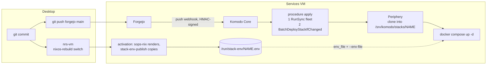
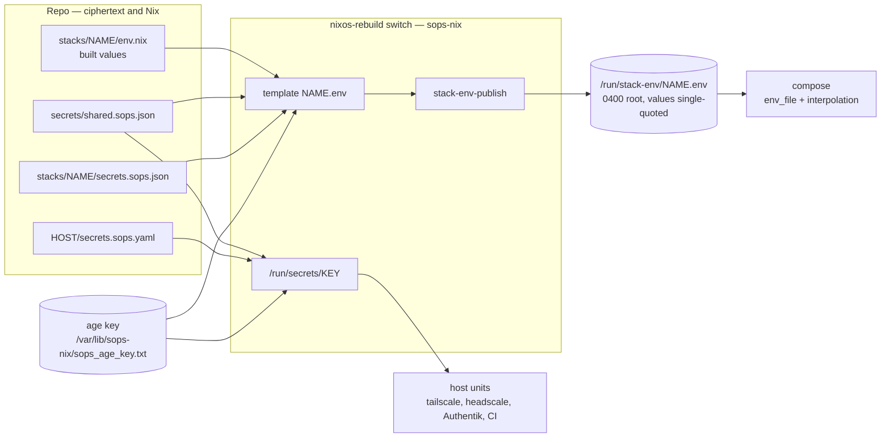

# Deploy — day-2 reference

Changing a fleet that already exists. Building it from nothing, or rebuilding
a host, is [bring-up.md](bring-up.md).

Paths are relative to the repo root. `nrs`, `nrs-vm`, `nrs-vps` and `hms` are
shell aliases (`aliases` lists them); `sopsedit`, `sopseditnvim` and `sopsgen`
are zsh functions. Both live in `nixos-de/home.nix`.

---

## The loop

```bash
# edit, then:
git add -A && git commit
nrs-vps                 # only if headscale-vps/ or a shared value the VPS reads changed
nrs-vm                  # only if nixos/, forgejo/, komodo/ (not komodo/sync/),
                        #   a stacks/*/env*.nix or ANY secret changed — always before the push
git push forgejo main   # the deploy, for stacks
```

| Target | Flake output | How a change reaches it |
|---|---|---|
| Services VM (Proxmox, `10.0.0.3`) | `.#services-vm` | OS, Forgejo, Komodo and every stack env: `nrs-vm`. Stacks: `git push forgejo main` |
| Headscale VPS (Hetzner) | `.#headscale-vps` | `nrs-vps` — builds the local flake and switches over SSH; no checkout on the host |
| Desktop | `.#desktop`, `homeConfigurations.idan` | `nrs` (system), `hms` (home) |

Rules:

- **Push to Forgejo.** `git push forgejo main` — GitHub is a push mirror, and
  a push that lands only there deploys nothing.
- **Switch before you push a secret.** The switch renders the env; the push
  only tells Komodo the ciphertext changed. Pushed first, the stack redeploys
  with its old env and the later switch triggers nothing — Deploy it in
  Komodo's UI.
- **An `env.nix`-only change** (or `env.<part>.nix`) is the one the push does
  not deploy: neither is a tracked config file. After `nrs-vm`, Deploy that
  stack in the UI.
- **OIDC, forward auth, LDAP: VPS first** — `nrs-vps`, `nrs-vm`, push. An app
  that turns OIDC on before its Authentik provider exists is a lockout, not a
  login page.
- **VPS log shipping: VPS last** — Alloy pushes *to* the
  `vlogs-ingest.svc.idanreed.com` vhost, so it must exist first
  ([bring-up.md §18](bring-up.md#18-vps-log-shipping)).
- **`nrs-vps` needs the desktop on the tailnet** (it targets `idan@vps` over
  MagicDNS). Before that: `nixos-rebuild switch --flake .#headscale-vps
  --target-host idan@<VPS_IP> --use-remote-sudo`.
- **Lints before a push to `main`:** `./tests/run.sh` (seconds);
  `./tests/run.sh deploy-check` before a live deploy.

---

## How a stack deploys



- **One webhook.** Forgejo's push webhook (signed with `KOMODO_WEBHOOK_SECRET`)
  calls `http://komodo:9120/listener/github/procedure/apply/main`. `apply` runs
  the `fleet` sync — register, update or remove every stack in
  `komodo/sync/stacks.toml` — then `BatchDeployStackIfChanged "*"`, which
  deploys every stack whose tracked files changed, in parallel. The sync's own
  deploy-on-sync is never used: it compares against a cache only the hourly
  poll refreshes.
- **`komodo/sync/stacks.toml`** has one `[[stack]]` block per `stacks/<name>`:
  a Komodo git stack that Periphery clones from `forgejo:3000` (the `komodo`
  bot's read-only token) into `/srv/komodo/stacks/<name>` and runs
  `compose.yaml` there. The `komodo-sync-coverage` lint holds every block to
  one shape.
- **What counts as a change** is `config_files`: `secrets.sops.json` (and
  `../../secrets/shared.sops.json` for a stack whose `env.nix` reads it) as
  `Redeploy`; every repo file a service bind-mounts as `Restart` for the
  services that mount it — the lint derives the list from `compose.yaml`. A
  push that changes only such a file restarts its consumers; one that changes
  `compose.yaml` too deploys only the services whose definition changed —
  restart the file's consumers from the UI.
- **Delete mode is on.** Removing a block destroys the stack (`compose down`).
  The sync is scoped by `match_tags = ["gitops"]`: every block carries the tag
  (the lint refuses one without), and nothing untagged — Core's `Local`
  server, system procedures, the sync, `apply`, anything made in the UI — is
  touched.
- **The sync and `apply` are host-owned** (`komodo/fleet.toml`):
  `komodo-sync-bootstrap` creates them and re-applies the file on every
  `nrs-vm` that changes it. They never move into `komodo/sync/`: `apply` runs
  the sync, and Komodo refuses to update a resource that is running.
- **Komodo and Forgejo are host units, not stacks** — Komodo deploys from
  Forgejo, so neither could bring the other up. Both run from the flake on
  `nrs-vm` (`bootstrap-komodo.service`, `forgejo.service`).
- **Deploy by hand:** Komodo UI → the stack → Deploy.

---

## Secrets



One age key encrypts everything; the private key lives only at
`/var/lib/sops-nix/sops_age_key.txt` (root) on each host, so every decrypt
costs a sudo. A value is stored **once**:

| File | Holds | Read by |
|---|---|---|
| `stacks/<name>/secrets.sops.json` | the stack's stored values | the services VM's render of that stack |
| `stacks/<name>/env.nix` | values BUILT from others — a URL around a password, an OIDC secret from the shared file (`secret "KEY"`, `shared "KEY"`) | the same render; a key both stored and built is an eval error |
| `stacks/<name>/env.<part>.nix` | values one service may see and the rest of the stack must not | renders to `/run/stack-env/<name>.<part>.env`, listed by that service only |
| `secrets/shared.sops.json` | OIDC client secrets, idan's password, the vlogs token, the LDAP secrets | both hosts (`secrets/shared.nix`) |
| `<host>/secrets.sops.yaml` | OS secrets: SSH keys, preauthkeys, CI tokens | sops-nix on that host, per key into `/run/secrets/<KEY>` |

`stack-env-publish` copies each rendered template to `/run/stack-env/<name>.env`
because `/run/secrets` is a per-generation symlink no container can bind-mount.
Compose reads the file twice: `env_file` for the containers and `--env-file`
(Komodo's `additional_env_files`) for `${VAR}` interpolation. Every value is
single-quoted, so a `$` in a password hash survives compose. The age key never
enters Periphery, the container that mounts the docker socket.

```bash
sopsedit <file>              # decrypt -> Zed -> re-encrypt in place
sopseditnvim <file>          # the same in nvim
sopsgen apply [--dry-run]    # fill every missing managed secret
sopsgen rotate <name>        # change one managed value and re-derive its hashes
sopsgen view <file>          # print decrypted values
sops -e -i <file>            # encrypt a NEW plaintext file (public key only)
```

- **Check `git diff` after a `sopsedit`.** If Zed's `--wait` returns at once
  against a running instance, sops re-encrypts the unedited tmpfile and the
  edit is silently lost.
- 🚨 **Never regenerate a secrets file from its template.** sops has no
  append-without-decrypt, so that destroys real key material. The base64
  `data:` blob's length gives the plaintext byte count (a real ed25519 key
  ~400 bytes encrypted, a `changeme_` placeholder ~40).
- A new stack secret is a key in `secrets.sops.json`, its
  `secrets.example.env`, the test fixture and a `secrets-gen/manifest.yaml`
  entry — `stack-env-drift` holds the three files to one key set.
- 🚨 **`sopsgen rotate user/idan` changes the secrets, not every login.**
  qBittorrent, Backrest, Beszel, Windmill, Jellyfin's local admin and
  Cleanuparr seed their credential once — the table and the reset for each is
  [bring-up.md §15](bring-up.md#15-accounts).

---

## Add a stack

A stack needs no image change and no deploy-plane change: a `[[stack]]` block
registers it and a push deploys it.

1. **Port** — the next free one in the domain's 50-port block in
   [services.md](services.md) (Infra 10000–10049, Media 10050–10099, Data
   10100–10149, Books 10150–10199, Notes 10200–10249, Automation 10250–10299,
   Tracking 10300–10349, Food 10350–10399, Util 10400–10449, Monitoring
   10450–10499, Game 10500–10549, Dev 10550–10599). Never reuse a released
   port without reading its row.
2. **`stacks/<name>/compose.yaml`:**
   - images pinned to an explicit tag;
   - publish on loopback only, `127.0.0.1:<port>:<internal>` (`network_mode:
     host` needs a `host-network-declared` lint entry);
   - absolute volumes: `/mnt/fast/<name>/…` for config and databases,
     `/mnt/slow/<purpose>/…` for bulk;
   - a healthcheck on every long-running service;
   - `env_file: /run/stack-env/<name>.env` when it has secrets (none
     otherwise — a missing env file aborts the stack);
   - `networks: [homelab]` (external) only to reach a sibling by name;
   - databases as `container_name: <name>_db` with the stack name as user —
     the backup loop and its lint key on that; MariaDB/MySQL get
     `stop_grace_period: 2m`;
   - a second database is created by an init one-shot if missing, never by an
     initdb-only script (that runs once, on an empty cluster);
   - a break-glass local admin uses an email no Authentik user has.
3. **Secrets** — `secrets.example.env` (every stored key, a `changeme_`
   placeholder and its generate command), manifest entries, `sopsgen apply`;
   built values in `env.nix`; a fixture at
   `tests/fixtures/stacks/<name>.sops.json` (`sops -e -i` — the fixtures rule
   encrypts to the test key).
4. **Register** — a `[[stack]]` block in `komodo/sync/stacks.toml`, copied
   from a neighbour, `tags = ["gitops"]`, `additional_env_files` and
   `config_files` set (`./tests/run.sh` prints any missing line).
5. **Pin** — `./tests/update-images.sh` (tag conventions differ per registry;
   the `image-pins` lint fails while a pin is stale).
6. **Directories** — `./nixos/generate-stack-dirs.sh`; it exits non-zero until
   the stack has a `STACK_NOTES` entry (and `DIR_NOTES` for non-root owners)
   in `nixos/generate-stack-dirs.py`. `git add nixos/stack-dirs.nix`.
7. **Inventory** — the row in [services.md](services.md) (`overview-sync`
   checks image and port).
8. **Suite** — the name in `stackChecks` in `tests/default.nix` for a
   conventional stack (`./tests/run.sh stack <name>`), or a bespoke
   `tests/suites/<name>.nix` registered in `tests/default.nix` and the
   `run.sh` case arm.
9. **Hostname** — a `<name>.svc.idanreed.com` handle in
   `stacks/caddy/Caddyfile`; forward auth (`import protected`) or OIDC (below),
   each with its Authentik blueprint landed by `nrs-vps` **first**; two Gatus
   probes (through Caddy with the real `Host:`, and on loopback); a Glance
   tile.
10. **Backups** — [below](#backups-and-the-restore-drill).
11. **Ship** — commit, `nrs-vm` (secrets or `/mnt` paths), push.

**Verify:** `./tests/run.sh` and the stack's suite; `docker ps -a --filter
name=<name>` shows every container running or an init exited 0; Komodo lists
the stack tagged `gitops`.

---

## Rotate a secret

```bash
sopsedit stacks/<name>/secrets.sops.json   # or secrets/shared.sops.json
git diff                                   # the edit took
git add -A && git commit
nrs-vps                                    # only for a shared value the VPS reads
nrs-vm                                     # BEFORE the push
git push forgejo main                      # apply redeploys the stack
```

OS secrets (`<host>/secrets.sops.yaml`) need only the commit and that host's
switch; on the VPS, `restartUnits` restarts both consumers of a rotated
headscale/Authentik secret (the `rotation` suite runs that contract).

Special cases:

- **A database password** is applied by initdb once. Change the role in the
  running database too: `docker exec -it <svc>_db psql -U <svc> -c "ALTER
  USER <svc> PASSWORD '<new>';"` (Komodo's is `komodo_db`, then `nrs-vm`).
- **`TAILSCALE_AUTH_KEY`:** mint `sudo headscale preauthkeys create -u
  <numeric-id> --reusable -e 24h` under `idan`, paste, switch, then `sudo
  systemctl start tailscale-autoconnect`.
- **`KOMODO_GIT_TOKEN`:** `docker exec -u 1000:1000 forgejo forgejo admin user
  generate-access-token --username komodo --token-name <new> --scopes
  read:repository --raw`, `sopsedit komodo/secrets.sops.json`, commit,
  `nrs-vm`; then delete the old token in the bot's Settings → Applications.
- **`KOMODO_WEBHOOK_SECRET`:** change it in sops **and** in the Forgejo
  webhook; until both match every push is refused.
- **`KOMODO_JWT_SECRET`:** rotating logs every Komodo session out; keep it
  pinned (unset regenerates per boot).
- **idan's password:** [bring-up.md §15](bring-up.md#15-accounts).
- **SSH identities:** replace the sops private half and the `ssh-pubkeys.nix`
  entry, switch. `storagebox_ed25519` is copied only when absent: `sudo rm
  /var/lib/backup/storagebox_ed25519 && sudo systemd-tmpfiles --create`, then
  restart backrest.

---

## Image updates

1. Edit the tag (`stacks/<name>/compose.yaml`, `komodo/compose.yaml`,
   `forgejo/compose.yaml`, `headscale-vps/authentik/compose.yaml`). Explicit
   tags only; check the registry's convention (some need a `v` prefix, some
   refuse one).
2. `./tests/update-images.sh` refreshes `tests/lib/images.nix`; one run at a
   time.
3. `./tests/run.sh` and the stack's suite.
4. Commit and push — `apply` redeploys the stack. Komodo and Forgejo go live
   with `nrs-vm`, Authentik with `nrs-vps`.

**Renovate** runs as a host timer on the VM (`nixos/modules/renovate.nix`) and
opens PRs for image tags and the flake lock; `renovate-pins.yml` re-pins the
digests on the PR branch. PRs are merged by hand, never automatically.

---

## Add an OIDC client

The client secret is one value in `secrets/shared.sops.json`, read by both
hosts: the VPS registers the client with it, the app presents it.

| # | File | Change |
|---|---|---|
| 1 | `secrets/shared.sops.json` (+ `secrets/shared.example.env`, `tests/fixtures/shared.sops.json`, a manifest entry) | `<NAME>_OIDC_CLIENT_SECRET`; `sopsgen apply` draws it |
| 2 | `headscale-vps/modules/authentik.nix` | a `<NAME>_OIDC_CLIENT_SECRET=${config.sops.placeholder.<NAME>_OIDC_CLIENT_SECRET}` line in the `authentik.env` template |
| 3 | `headscale-vps/authentik/compose.yaml` | the variable in the **worker**'s environment (the worker applies blueprints) |
| 4 | `headscale-vps/authentik/blueprints/custom/<name>-oidc.yaml` | provider + application, `client_secret: !Env <NAME>_OIDC_CLIENT_SECRET`, `client_id` = slug = the service name — or `<name>-sso` when the service is also forward-authed (`forward-auth.yaml` owns the bare name). An admin tool also binds the application to the `Admin` group (copy `grafana-oidc.yaml`) |
| 5 | `stacks/<app>/env.nix` | the app's variable: `<VAR> = shared "<NAME>_OIDC_CLIENT_SECRET";` — the app-side name is whatever the app reads |
| 6 | `komodo/sync/stacks.toml` | `../../secrets/shared.sops.json` as a `Redeploy` config file |

Then `sopsgen apply`, commit, `nrs-vps`, `nrs-vm`, push.

Rules the `oidc-contract` lint enforces or a silent failure punishes:

- `!Env`, never `"${VAR}"` — a bare `${VAR}` is stored literally.
- Blueprint files end `.yaml` (discovery skips `.yml`) and carry `version: 1`
  and the `instantiate: "true"` label; a comment-only `attrs:` parses as null
  and kills the whole blueprint.
- Provider names are unique across all provider types and slugs are unique;
  a reused one rolls the whole blueprint back, visible only in the worker log.
- Every provider declares `grant_types: [authorization_code, refresh_token]`;
  an empty list fails every login as `invalid_request`.
- Issuer URL: `https://auth.idanreed.com/application/o/<slug>/`.

**Verify:** `./tests/run.sh authentik`, then one real login.

---

## Add an SSH identity

```bash
ssh-keygen -t ed25519 -f /tmp/foo -N '' -C foo
```

1. Public half → the `foo` entry in `ssh-pubkeys.nix` (every host builds its
   `authorizedKeys` from it — never hand-edit `authorizedKeys`). Client-only
   identities for third-party forges get no entry.
2. Private half → sops as a YAML block scalar: `ssh/foo` in
   `nixos-de/secrets.sops.yaml` for a desktop identity, or the owning host's
   `secrets.sops.yaml`.
3. A desktop identity also gets an entry in `nixos-de/ssh-identities.nix`
   (host, user, port, `extraOptions`), which generates the sops declaration
   and the ssh Host block.

Then `shred -u /tmp/foo*`, `./tests/run.sh`, and `hms` (client) or the host's
switch.

---

## Backups and the restore drill

| Time | What | Where |
|---|---|---|
| 02:45 | `backup-prepare` — database dumps to `/mnt/fast/_dumps`, the VPS pull to `/mnt/fast/_vps` | host timer, `nixos/backup-prepare.sh` |
| 03:00 | `fast-volume` — `/mnt/fast` → restic `sftp:storagebox:/home/restic` | Backrest |
| 04:00 | `slow-volume-selective` — the `/mnt/slow` directories listed in `stacks/backrest/config.template.json` | Backrest |
| Sun 04:00 | prune | Backrest |
| 1st 05:00 | `restic check`, 5 % read | Backrest |
| 12:00 | `backup-staleness-check` — local stamp > 48 h or VPS stamp > 7 d pages | host timer |

Retention is daily 7 / weekly 4 / monthly 6. Errors go to ntfy; the
healthchecks.io dead-man is pinged on `fast-volume` success only, so a backup
that stopped running is caught by its absence. The diagram is in
[bring-up.md §16](bring-up.md#16-hetzner-storage-box-and-backrest).

**Routine check:** `cat /mnt/fast/_dumps/.last-success-{local,vps}` and
`ls -lh /mnt/fast/_dumps/` on the VM, the Backrest snapshot list, the
healthchecks.io dashboard. A stack stopped on purpose goes in
`BACKUP_SKIP="<stack> <container>"` on `backup-prepare.service` rather than
paging nightly.

**The restore drill** (twice a year, and after a major version bump — no
suite restores from the Storage Box):

```bash
export RESTIC_PASSWORD='<from stacks/backrest/secrets.sops.json>'
restic -r sftp:storagebox:/home/restic snapshots
restic -r sftp:storagebox:/home/restic restore <snapshot-id> \
  --target /tmp/restore-drill --include /mnt/fast/paperless --include /mnt/fast/_dumps
docker run --rm -d -e POSTGRES_PASSWORD=scratch --name drill postgres:17
docker exec -i drill psql -U postgres < /tmp/restore-drill/mnt/fast/_dumps/paperless.sql
sqlite3 /tmp/restore-drill/mnt/fast/_dumps/vaultwarden.sqlite '.tables'
```

The `storagebox` alias exists only in the backrest container; elsewhere give
restic the sub-account on port 23, `/var/lib/backup/storagebox_ed25519` and the
pinned `stacks/backrest/known_hosts`. A full-host restore is
[bring-up.md Appendix A](bring-up.md#appendix-a--restore-mntfast-from-restic).

**Wiring a stack into backups:** Postgres — `<name>_db`, user `<name>`, the
name in `backup-prepare.sh`'s `pg_dumpall` loop; SQLite — a `sqlite_backup
<name> <path>` line; MariaDB — `mariadb-dump` (MariaDB 11 dropped the `mysql*`
names). Caches and derived data are excluded in `config.template.json`, which
`config-init` seeds **once** — on a live host edit the plan in the UI too.
`**/pgdata/**` stays excluded everywhere; the dumps are the backup. The
`backup-coverage` lint holds the dump list against the stacks; a deliberate
omission is a named `NOT_BACKED_UP` entry.

---

## Troubleshooting

**Nothing deployed after a push.**

1. Forgejo → the repo → Settings → Webhooks → Recent Deliveries. A refused
   delivery is the URL, the allow-list (`forgejo/compose.yaml`) or
   `KOMODO_WEBHOOK_SECRET`.
2. Komodo → Updates → the `apply` run. Its error names only the **first**
   failed stack; the others still deploy, and a failed one keeps its old
   contents until the next push or a UI Deploy. Judge by `docker ps -a`.
3. A secret that did not land: the push came before the switch — `nrs-vm`,
   then Deploy.
4. A bind-mounted file that did not land: the same push changed
   `compose.yaml`, so only changed services were redeployed — restart the
   file's consumers.
5. Registration: `journalctl -u komodo-sync-bootstrap`. "still a placeholder"
   is an unminted `KOMODO_GIT_TOKEN`; a failed clone is a token from another
   Forgejo or a bot without Read.

**An init stuck `Created`** after a deploy is a start-order race: `docker
start <name>` once its dependency is healthy, or Deploy again. An init that
**exits non-zero** is a real failure, usually a `changeme` value — fix the
secret. Komodo shows a stack with exited inits as "unhealthy"; `docker ps -a`
is the truth.

**A new stack's container cannot write its bind mount:** its tmpfiles rules
land only at the next switch, and docker creates a missing bind source
root-owned. `./nixos/generate-stack-dirs.sh`, `nrs-vm`, redeploy.

**MariaDB crash-loops on `Bad magic header in tc log`:** it was killed
mid-shutdown. Move `tc.log` aside and redeploy.

**VPS log shipping** — from a tailnet client, `curl -o /dev/null -w
'%{http_code}\n' https://vlogs-ingest.svc.idanreed.com/`:

| Code | Means |
|---|---|
| `404` | Caddy is not serving the current Caddyfile — check `apply`, or restart caddy |
| `503` | `VLOGS_INGEST_TOKEN` is empty; the vhost refuses everything. `sopsgen apply`, commit, `nrs-vm`, push |
| `401` | healthy — the token gate refuses an unauthenticated caller |

A 401 in `journalctl -u alloy` on the VPS means the two hosts rendered
different generations of the token — switch both. In Grafana, empty panels
with a non-zero *VPS lines shipped* are a query problem; a zero means nothing
arrives.

**OIDC logins fail with `invalid_request`** (headscale says "missing code or
state parameter"): the provider's `grant_types` is empty.

**A node registers but reaches nothing:** it registered under a cached
`akadmin` session, and a node keeps the user it registered under. `sudo
headscale nodes delete -i <node> --force`, then log it in again from a private
window as `idan` (`tailscale up --login-server=https://headscale.idanreed.com
--force-reauth`).

**Two headscale users named `idan`:** the ACL's `idan@` resolves to neither
and every node loses access. Rename one (`headscale users rename -i <id>
--new-name <other>`) and re-register its nodes under the one that stays. A
fresh Authentik database in front of a kept headscale database does this too
— every `sub` changes
([bring-up.md §0.1](bring-up.md#01-what-a-reset-destroys)).

**GPU work** (Jellyfin QSV, Frigate OpenVINO, Immich ML) runs on CPU until the
Arc A380 passthrough lands; that is expected, not a fault.
