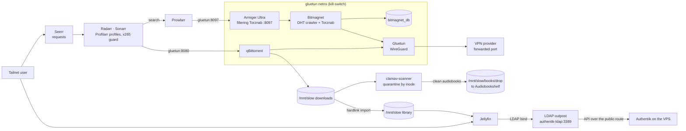

# Service inventory

Every service: its port, volume, auth and image, plus the network and naming
around them. Kept in step with the compose files by hand, in the same commit
as the stack change; the `overview-sync` (port and image) and
`auth-column-parity` / `forward-auth-coverage` (Auth) lints read this file.

**Auth column** — what a service adds on top of tailnet membership:

| Value | Means |
|---|---|
| `OIDC` | native OpenID Connect against Authentik |
| `FwdAuth` | Caddy forward auth to Authentik (the app has no SSO of its own) |
| `(Admin)` | the Authentik application is bound to the `Admin` group: idan only |
| `LDAP` | Authentik's LDAP outpost (Jellyfin) |
| `SAML` | SAML 2.0 against Authentik (DocSpace) |
| `Local` | the app's own accounts |
| `--` | nothing |

A `*` marks a caveat in the row's notes. Tailnet membership is
authentication, not authorization: invited users' devices reach the services
VM's `:443` and nothing else, and Caddy fronts every vhost there, so the
per-app control is the Auth column ([accounts.md](accounts.md)).

## Network

| Address | Host | Notes |
|---|---|---|
| `10.0.0.1` | OPNsense | router, firewall, VLANs, the Tailscale subnet router |
| `10.0.0.2` | Proxmox | hypervisor |
| `10.0.0.3` | services VM | NixOS docker host (VM 110) |
| `10.0.0.4`–`.10` | — | static assignments |
| `10.0.0.11`+ | — | DHCP |
| `10.0.10.0/24` | IoT VLAN | cameras and smart devices: no internet, may reach only the services VM; reachable remotely through the OPNsense subnet router |
| `100.64.0.1` | headscale VPS | tailnet; joins first, so it takes the first address |
| `100.64.0.2` | services VM | tailnet; the ACL's `services-vm` host, Caddy's `TAILNET_IP` |

OPNsense, its VLANs and firewall rules, and Proxmox itself are configured by
hand; nothing in this repo manages them.

## DNS and naming

Three namespaces, kept apart — headscale refuses to start if `server_url`'s
host is inside `dns.base_domain`:

| Name | For | Resolves via | Public record |
|---|---|---|---|
| `headscale.idanreed.com` | headscale control plane + DERP | A → the VPS | yes |
| `auth.idanreed.com` | Authentik, the OIDC issuer | A → the VPS | yes |
| `*.tailnet.idanreed.com` | MagicDNS node names | each client's tailscale resolver | **no** |
| `*.svc.idanreed.com` | home services behind Caddy | A → the services VM's tailnet IP | yes, a `100.64.0.0/10` address |

Publishing a CGNAT address is deliberate: it is meaningless off the tailnet,
needs no split-horizon resolver and no DNS server of our own, and DNS-01 still
works because the zone is real. `dns.nameservers.global` is unset, so tailnet
clients keep their own resolvers.

## Storage

| Mount | Partlabel | Disk | Holds |
|---|---|---|---|
| `/` | (image fs `nixos`) | SSD | NixOS root, rebuilt from the flake |
| `/srv` | `state` | SSD | Komodo's state and its stack clones (`/srv/komodo`) |
| `/mnt/fast` | `fast` | SSD | container config and databases; docker's data root |
| `/mnt/slow` | `slow` | HDD | bulk: media, books, photos, recordings, logs — one filesystem, so imports are hardlinks |

## Ports

Each domain owns a 50-port block from 10000; the first port is its primary
service. Take the next free port in the block from the tables below. VPS
services use standard ports.

| Block | Domain |
|---|---|
| 10000–10049 | Infra |
| 10050–10099 | Media |
| 10100–10149 | Data |
| 10150–10199 | Books |
| 10200–10249 | Notes / Sync |
| 10250–10299 | Automation |
| 10300–10349 | Tracking |
| 10350–10399 | Food |
| 10400–10449 | Util |
| 10450–10499 | Monitoring |
| 10500–10549 | Game |
| 10550–10599 | Dev |

## Services

### Media (10050-10099)

The arrs reach qBittorrent and Armiger by name at `gluetun:<port>`: gluetun
admits its own docker subnet, and its firewall passes only the two publishes
(qBittorrent's UI, Bitmagnet's UI). With the tunnel down nothing in the netns
has egress, and the gluetun-healthy gate keeps them stopped.

| Name               | Volume    | Port          | Auth     | Image                                          | Notes                                                     |
|--------------------|-----------|---------------|----------|------------------------------------------------|-----------------------------------------------------------|
| Jellyfin           | fast+slow | 127.0.0.1:10050 | LDAP + local | `jellyfin/jellyfin:10.11.11`             | Media player/server, Arc A380 HW transcode. Users sign in with their Authentik username and password through `jellyfin-plugin-ldapauth` (23.0.0.0, installed and configured by the inits) against the LDAP outpost — server-side, so every TV and mobile client works; the Jellyfin account is created at first login, `Admin` members become Jellyfin admins. Password only (LDAP cannot ask for a second factor). The local `idan` admin is the break-glass: an existing account always authenticates with its own provider, so `idan` stays local and LDAP never creates a second one |
| Radarr             | fast+slow | 127.0.0.1:10051 | FwdAuth | `lscr.io/linuxserver/radarr:6.3.0`            | Movie management.                               |
| Sonarr             | fast+slow | 127.0.0.1:10052 | FwdAuth | `lscr.io/linuxserver/sonarr:4.0.19`           | TV management.                                  |
| Prowlarr           | fast      | 127.0.0.1:10053 | FwdAuth | `lscr.io/linuxserver/prowlarr:2.5.2`          | Indexer management. media-init adds the Armiger indexer (Bitmagnet behind Armiger's filter) once Bitmagnet's index has results |
| Seerr              | fast      | 127.0.0.1:10054 | Local* | `ghcr.io/seerr-team/seerr:v3.4.1`              | Request UI. Signs in with Jellyfin accounts, so LDAP users too (*no OIDC on the stable tag) |
| Bazarr             | fast+slow | 127.0.0.1:10055 | FwdAuth | `lscr.io/linuxserver/bazarr:1.6.0`            | Auto-download subtitles for Radarr/Sonarr.      |
| Profilarr          | fast      | 127.0.0.1:10056 | FwdAuth + OIDC (Admin) | `ghcr.io/dictionarry-hub/profilarr:2.2.0`     | Syncs Dictionarry H265 profiles to *arr (Dictionarry DB ONLY) |
| qBittorrent        | fast+slow | 127.0.0.1:10057 | **Local** | `lscr.io/linuxserver/qbittorrent:5.2.3`     | Download client in gluetun's netns; UI published by gluetun. No Caddy handle exists yet, so the only control is its own WebUI credential, seeded by `qbit-init` from the stack env (`WebUI\LocalHostAuth=false` — a loopback request bypasses it). Add the forward-auth blueprint entry before adding the route. Shares gluetun's netns, so it stays `Created` until the VPN credentials land |
| Gluetun            | fast      | --            | --       | `qmcgaw/gluetun:v3.41.3`                       | VPN tunnel + kill-switch for qBittorrent, Bitmagnet, its database and Armiger (all in its netns). **Provider-agnostic**: the compose names no provider and sets no `VPN_SERVICE_PROVIDER`; everything provider-specific arrives from the stack's sops file (selection criterion: port-forwarding support). The whole media download path is blocked until those credentials are filled |
| ClamAV             | fast+slow | --            | --       | `clamav/clamav:1.5`                            | Scans all qBit downloads (3310 internal, poll-watcher quarantines BY INODE — every hardlink to the infected file is unlinked too). Also promotes clean `audiobooks`-category downloads into /mnt/slow/books/drop after the verdict |
| Cleanuparr         | fast      | 127.0.0.1:10058 | FwdAuth + OIDC (Admin) | `ghcr.io/cleanuparr/cleanuparr:2.10.5`        | Queue cleanup: stalled/bad downloads, malware detection. |
| Bitmagnet          | fast      | 127.0.0.1:10059 | FwdAuth (Admin) | `ghcr.io/bitmagnet-io/bitmagnet:v0.10.0` | Self-hosted DHT crawler + Torznab indexer, in gluetun's netns (the crawl leaves only through the tunnel; with it down the kill-switch holds it at zero egress and the gluetun-healthy gate keeps it stopped). Its UI publish rides gluetun's ports; the UI, GraphQL API and `/import` have no auth of their own, hence forward auth bound to `Admin`. TMDB matching on, with Bitmagnet's built-in rate-limited key. Healthy = HTTP up + database reachable (its `/status` also reports TMDB and the DHT, which go down with the tunnel) |
| Bitmagnet DB       | fast      | --            | --       | `postgres:16.13-alpine`                        | `bitmagnet_db`, loopback-only inside gluetun's netns. The index is regenerable by re-crawling, so it is deliberately NOT dumped (`ENGINES_NOT_DUMPED` in the backup-coverage lint) |
| Armiger            | --        | -- (`gluetun:8097`) | --  | `ghcr.io/spencernorton/armiger:3.4.1`          | Armiger **Ultra** (Apache-2.0, no licence key): tags what Bitmagnet indexes and fronts its Torznab with a filter (executable lures, junk, honeypots dropped). Prowlarr's `Armiger (Bitmagnet)` indexer is added by media-init and pushed to Radarr/Sonarr. In gluetun's netns; model baked into the image — no downloads, no DHT model updates, nothing shared. No UI |
| qbit_manage        | --        | --            | --       |                                                | **Planned** — no stack exists in the repo. Torrent hygiene: orphans, share limits, tagging |
| Dictionarry DB     | --        | --            | --       | (remote git repo)                              | Community custom formats + quality profiles for Profilarr |
| SuggestArr         | slow      | --            | FwdAuth  |                                                | **Planned**. Media suggestions for Jellyfin |
| Helmarr / nzb360   | Phone     | --            | --       |                                                | Mobile *arr management app                                |

### Data (10100-10149)

| Name               | Volume    | Port          | Auth     | Image                                          | Notes                                                     |
|--------------------|-----------|---------------|----------|------------------------------------------------|-----------------------------------------------------------|
| Paperless-ngx      | fast      | 127.0.0.1:10100 | OIDC   | `ghcr.io/paperless-ngx/paperless-ngx:2.20`     | Document management + OCR. Admin is a manual `/admin` grant to the SSO `idan` until the image moves past 2.20 |
| Immich             | fast+slow | 127.0.0.1:10102 | OIDC   | `ghcr.io/immich-app/immich-server:v3.1.0`      | Photo management. Lockstep companions: machine-learning v3.1.0, `ghcr.io/immich-app/postgres:17-vectorchord1.1.1`, `valkey/valkey:9.1-alpine` |
| Grist              | fast      | 127.0.0.1:10101 | OIDC   | `gristlabs/grist-oss:1.7.21`                   | **Evaluation**, idan only — relational spreadsheets. One container, all state under `/mnt/fast/grist` (uid **1001**): `home.sqlite3` plus one SQLite file per document in `docs/`, each `.backup`ed by backup-prepare.sh. Authentik OIDC is the only login (`grist-oidc.yaml`, Admin group only) with `GRIST_FORCE_LOGIN`; site creation off and the UI pinned to `home`, so idan owns the one team site `home` (created at boot for `GRIST_ADMIN_EMAIL`) and is install admin by email — no first-login step. 🚨 OIDC discovery is BOOT-FATAL: with Authentik unreachable the container restart-loops until it answers. Break-glass: `GRIST_BOOT_KEY` at `/boot` (printed to the container log at every start). Formulas run in gVisor (`GRIST_SANDBOX_FLAVOR=gvisor`, default docker privileges; the image default is unsandboxed). `grist-oss` image, BARE tag; `GRIST_IN_SERVICE=true` skips the Quick setup wizard; 🚨 `GRIST_PERSONAL_ORGS` must stay true — a fresh install exits at boot without its support user's personal site |

### Books (10150-10199)

| Name               | Volume    | Port          | Auth     | Image                                          | Notes                                                     |
|--------------------|-----------|---------------|----------|------------------------------------------------|-----------------------------------------------------------|
| Kavita             | fast+slow | 127.0.0.1:10150 | OIDC   | `jvmilazz0/kavita:0.9.1`                       | Ebook library (EPUB+PDF), OPDS feed, KOReader sync. Native OIDC on (`Admin` members get Kavita's admin role from a `roles` claim); the local admin stays as break-glass, and OPDS/KOReader keep API-key auth. Tag has no `v` and is NOT the 4-part release number |
| Shelfmark          | fast+slow | 127.0.0.1:10151 | FwdAuth | `ghcr.io/calibrain/shelfmark:1.3.13`          | Search + download, EBOOKS ONLY (upstream's Direct Download source declares supported_content_types = ["ebook"]); it mounts only the ebook tree. Audiobooks arrive from the media stack's `audiobooks` qBittorrent category via /mnt/slow/books/drop. Its own auth is `none`, hence FwdAuth. Anna's Archive direct download needs operator-supplied `AA_MIRROR_URLS` (and `AA_DONATOR_KEY` for the fast endpoints); without them that source is inert. Its admin is the `Admin` group (`PROXY_AUTH_ADMIN_GROUP_NAME`) |
| Audiobookshelf     | fast+slow | 127.0.0.1:10152 | OIDC   | `ghcr.io/advplyr/audiobookshelf:2.36.0`        | Audiobook library + player, progress sync. OIDC on; `books-init` gives root idan's email before switching it on, so the first SSO login links root. Two library folders: the curated /mnt/slow/books/audiobooks tree and /mnt/slow/books/drop, the media stack's post-ClamAV audiobook hand-off, picked up by an hourly library scan cron |
| KOReader           | Tablet    | --            | --       |                                                | EPUB reader on reMarkable 2, connects via OPDS. Tablet-side (Toltec), not a server component |

### Notes / Sync (10200-10249)

| Name               | Volume    | Port          | Auth     | Image                                          | Notes                                                     |
|--------------------|-----------|---------------|----------|------------------------------------------------|-----------------------------------------------------------|
| rmfakecloud        | fast      | 127.0.0.1:10200 | **Local** | `ddvk/rmfakecloud:0.0.31`                   | reMarkable cloud replacement. **Local, not forward auth:** the tablet is a non-interactive JWT client and ~40 of its ~45 routes are tablet paths, so a forward-auth exclusion list would BE the data plane. It authenticates its own `/ui/*` with argon2id + JWT. 🚨 First login creates the admin, unauthenticated — never point Caddy here before the admin exists |
| Syncthing          | fast      | 127.0.0.1:10201 / **0.0.0.0:22000** | FwdAuth (GUI) + local | `syncthing/syncthing:2.1.3` | Bidirectional sync (server <-> reMarkable). The GUI gets forward auth (bound to `Admin`) plus its own seeded credential. **22000 is the fleet's only bare publish** — BEP peers dial this host, and it is safe because BEP is mutually authenticated by device certificate. Named exemption in the `loopback-binding` lint. ⚠ 2.x index migration is ONE-WAY |
| SilverBullet       | fast      | 127.0.0.1:10202 | FwdAuth + local | `ghcr.io/silverbulletmd/silverbullet:2.9.0` | File-on-disk markdown wiki; the space is mirrored to a Forgejo repo by a sidecar so Obsidian can edit the same files. **Three wikis run side by side for comparison** (with BookStack 10300 and Outline 10203). FwdAuth (bound to `Admin`) plus its own `SB_USER` — it cannot read `X-Authentik-*`, so two logins. NO `skip_path_regex`: measured, every unauthenticated path it serves is a same-origin browser request, and the PWA service worker is turned off rather than exempted. 🚨 The image runs shell commands for logged-in users BY DEFAULT (`SB_SHELL_BACKEND=off` disables it), `SB_READ_ONLY=false` **enables** read-only mode, and `/space/CONTAINER_BOOT.md` is executed as bash at every start. Pinned at 2.9.0: 2.10.0 is a different runtime generation whose healthcheck moved to `/.instance` and which no longer logs the shell-backend state, so the pin stays until those are re-measured; `latest` is a separate `2.10.0-runtime-api` branch build |
| Outline            | fast      | 127.0.0.1:10203 | OIDC     | `outlinewiki/outline:1.9.2`                    | Database-backed wiki (own Postgres `outline_db` + redis), the comparison against BookStack and SilverBullet. **No local accounts of any kind** — the Authentik OIDC provider IS the login, and the first sign-in owns the workspace. `FILE_STORAGE=local`; S3 is NOT required. Endpoints are configured manually, not by discovery, so the container boots and reports healthy with Authentik unreachable — what breaks then is logging in, which no healthcheck can see. `PGSSLMODE=disable` is mandatory. Version numbering: 0.87 → 1.0, so 1.9.2 is newer than 0.8x. Compose builds the app's `DATABASE_URL` from `POSTGRES_PASSWORD`, so the two cannot drift |
| keywriter          | Tablet    | --            | --       |                                                | Markdown editor on reMarkable 2                           |

### Automation (10250-10299)

| Name               | Volume    | Port          | Auth     | Image                                          | Notes                                                     |
|--------------------|-----------|---------------|----------|------------------------------------------------|-----------------------------------------------------------|
| Home Assistant     | fast      | 127.0.0.1:10250 | Local* | `ghcr.io/home-assistant/home-assistant:2026.8.3` | Lights + alarms. Local accounts; `automation-init` onboards idan as owner. *OIDC via the hass-oidc-auth custom component is deferred — its pip deps land in the container's ephemeral layer. NOT forward-auth-able: /api/webhook/* is unauthenticated by design. `stable` and `2026.8` are both MOVING tags |
| Mosquitto          | fast      | 127.0.0.1:10251 | Local  | `eclipse-mosquitto:2.0.22`                     | MQTT broker: Frigate publishes, Home Assistant consumes. Password file generated from sops at every start. Pinned to 2.0.x on purpose — 2.1 changed its password hash, chown scope and symlink handling, and ships `-alpine` only |
| Frigate            | fast+slow | 127.0.0.1:10252 | FwdAuth | `ghcr.io/blakeblackshear/frigate:0.17.2`       | NVR + object detection. Two Reolink cameras (`cam_a`, `cam_b`) over go2rtc http-flv restreams, recording from main and detecting on sub. Authentik group `Admin` maps to Frigate admin, everyone else `viewer`. Detector: **OpenVINO on the Arc A380 (`device: GPU`), not a Coral**, once GPU passthrough lands (it waits on a Proxmox upgrade); the **CPU detector** until then. Cameras are operator hardware. Publishes **8971** (authenticated) — port 5000 is an unauthenticated forced-admin bypass and must never be published. No `v` prefix on the tag |
| Windmill           | fast      | 127.0.0.1:10253 | **FwdAuth + OIDC** | `ghcr.io/windmill-labs/windmill:1.798.1` | Workflow orchestration: reMarkable OCR, Paperless AI, generic LLM tasks. **Auth**: forward auth, then Windmill's own login — idan by password as the superadmin; anyone else only as a windmill-init roster line, through Authentik (`windmill-sso`; the CE image ships the OAuth code, up to 10 SSO users, and SSO never creates an account). 🚨 **In-fleet API callers must use `127.0.0.1:10253`, not the vhost** — forward auth 302s every webhook. `latest` is the MAIN BRANCH build, not a release. Its own stack at 10253 (own Postgres, `windmill_db`) |
| Windmill Worker    | Desktop   | --            | --       | `ghcr.io/windmill-labs/windmill` (worker mode) | GPU worker for Ollama tasks, runs on desktop              |
| Ollama             | Desktop   | --            | --       | Native install (localhost only)                | LLM inference, accessed by GPU worker only                |

### Tracking (10300-10349)

| Name               | Volume    | Port          | Auth     | Image                                          | Notes                                                     |
|--------------------|-----------|---------------|----------|------------------------------------------------|-----------------------------------------------------------|
| Bookstack          | fast      | 127.0.0.1:10300 | OIDC   | `lscr.io/linuxserver/bookstack:version-v26.05.4` | Personal wiki. MariaDB companion (`bookstack_db`). Tag keeps the `v`, unlike most of this range |
| Homebox            | fast      | 127.0.0.1:10301 | OIDC   | `ghcr.io/sysadminsmedia/homebox:0.26.2`        | Home inventory, SQLite. Upstream moved — `hay-kot/homebox` was archived in 2024. Resolves OIDC discovery at STARTUP, so it needs Authentik reachable to boot |
| Karakeep           | fast      | 127.0.0.1:10302 | OIDC   | `ghcr.io/karakeep-app/karakeep:0.33.2`         | Bookmarks + optional AI (inert without an inference endpoint). Meilisearch + a chrome sidecar. `latest` is the NIGHTLY build; the release alias is `release` |
| Firefly III        | fast      | 127.0.0.1:10303 | FwdAuth | `fireflyiii/core:version-6.6.6`               | Money tracking. No OIDC in core at all, so forward auth is the only SSO path; its remote-user guard makes the first email it sees the owner, so idan opens it first. Postgres companion (`firefly_db`) |
| Firefly Importer   | --        | 127.0.0.1:10305 | FwdAuth | `fireflyiii/data-importer:version-2.3.4`      | SimpleFIN import. Its UI has NO auth of its own and holds a full-privilege API token, so its forward-auth application is bound to `Admin`. Requires core >= 6.6.0 |
| Dawarich           | fast      | 127.0.0.1:10304 | OIDC   | `freikin/dawarich:1.14.0`                      | Location tracking. Needs **PostGIS**, not plain Postgres, plus redis and a separate sidekiq worker. Note the image org is `freikin`, the GitHub org is `freika` |
| Ghostfolio         | fast      | 127.0.0.1:10306 | OIDC   | `ghostfolio/ghostfolio:3.65.0`                 | **Evaluation** — trying it before committing; no SimpleFIN/Firefly linkage. Wealth/portfolio tracker. Own Postgres (`ghostfolio_db`, in the `pg_dumpall` loop) + own passwordless Redis (cache, no volume — argv `--requirepass` rejected, project-private network). Accounts have NO password: a one-time security token hashed with `ACCESS_TOKEN_SALT`, which must NEVER be rotated. Docker Hub only, BARE tag, releases ~daily. `npx prisma migrate deploy` at every start is offline-safe (proven by `run.sh stack ghostfolio`). **OIDC is ON** with all three `OIDC_*_URL` overrides set — which is what makes it safe: `ENABLE_FEATURE_AUTH_OIDC=true` without them makes discovery boot-fatal. Local token login remains underneath. The first account becomes ADMIN, so idan logs in first |
| Owl                | --        | 127.0.0.1:10307 | FwdAuth | `owlplanner/owldocker:2026.8.29`               | **Evaluation** — retirement planner (Streamlit). 🚨 NO auth of any kind, so forward auth is a hard precondition, not defence in depth — and `/_stcore/*` must NEVER be excluded, the websocket IS the app. NO volume and none wanted: cases save/load through the browser, so a restart loses unsaved work by design. Runs as uid **1001**, not 1000. 🚨 Never `:edge` — it `git clone`s + `uv sync`s from the entrypoint on every start; the dated tag bakes deps at build. amd64 only |
| Actual Budget      | fast      | 127.0.0.1:10308 | OIDC* | `actualbudget/actual-server:26.9.0`            | **Evaluation** — the bake-off's contested rival to Firefly III (10303/10305): native SimpleFIN + native OIDC in ONE SQLite container. Runs as uid **1001** (like Outline) — pinned by compose `user:`, because the published image creates the uid and then ships NO USER instruction (root without the pin; measured). Headless first-run: `actual_init` POSTs /account/bootstrap — verified in v26.9.0 source and asserted by `run.sh actual`; init fails closed on an empty/changeme_ password. Docker tag is BARE (`26.9.0`; the git tag has the `v`). *OIDC enabled by actual-init once the issuer answers (the server itself is never handed ACTUAL_OPENID_* env) — actual-init seats `idan` as ADMIN before that, so no other first OIDC login can claim the server; the password stays a fallback. /health is liveness-only. The SimpleFIN credential is pasted in-app and stored in account.sqlite's secret table (inside the backup payload, unlike Firefly's config-JSON); core has NO scheduled sync |
| Wealthfolio        | fast      | 127.0.0.1:10309 | Local* | `wealthfolio/wealthfolio:3.7.0`                | **Evaluation** — the Ghostfolio (10306) bake-off rival: same job, ONE container + ONE SQLite file. All state under /mnt/fast/wealthfolio (wealthfolio.db + secrets.json, provider keys encrypted with WF_SECRET_KEY — 🚨 rotating that key orphans secrets.json). Docker Hub `wealthfolio/` org (moved from `afadil/` at v3.4.0), BARE tag. Runs as uid 1000, NO chown — dir must be 1000:1000. Auth: Argon2id `WF_AUTH_PASSWORD_HASH` (single-quote it — finding #30's $-mangling; at 3.7.0 a mangled hash is BOOT-FATAL with an error naming the fix). Needs a `sqlite_backup wealthfolio` line in backup-prepare.sh. *Native OIDC (v3.6.0+) ships OFF: discovery is BOOT-FATAL at startup with NO override — worse than Ghostfolio's |
| Todo / project org | fast      | --            | TBD      |                                                | TBD: OpenProject / Planka / Vikunja etc.                  |

### Food (10350-10399)

| Name               | Volume    | Port          | Auth     | Image                                          | Notes                                                     |
|--------------------|-----------|---------------|----------|------------------------------------------------|-----------------------------------------------------------|
| Tandoor            | fast      | 127.0.0.1:10350 | OIDC   | `ghcr.io/tandoorrecipes/recipes:2.6.13`        | Recipe management. **Its own stack**, separate from Wger: both are Django and both read the BARE name `SECRET_KEY`, and `env_file` gives every service in a project the whole `.env`. 🚨 With `DB_ENGINE`/`POSTGRES_DB` absent it silently falls back to an EPHEMERAL SQLite file and does not even wait for Postgres — so those live in `compose.yaml`, not `.env`. ⚠ Never set `REMOTE_USER_AUTH`: it removes the only path to a first admin |
| Wger               | fast      | 127.0.0.1:10351 | FwdAuth + OIDC | `wger/server:2.6`                             | Calorie / workout tracking. **Its own stack** (see Tandoor). The published port is the **nginx sidecar**, not gunicorn — `wger/server` serves no static files at all. 🚨 `wger bootstrap` creates an `admin` account with the published password `adminadmin` and there is NO env var to change it; `wger_init` does. Tag `2.6`, NOT `2.6.0` (tracks master) or `latest` (a 2.7 alpha) |
| Mealie             | fast      | 127.0.0.1:10352 | OIDC   | `ghcr.io/mealie-recipes/mealie:v3.24.0`        | Recipe management — **evaluation**, the Tandoor head-to-head. Single container, **SQLite ON PURPOSE**: the engine switch treats ANY value but the exact string `postgres` — unset, empty, even the typo `postgresql` — as sqlite with no log, and PostgresProvider defaults the password to `mealie`; deliberate sqlite on the bind mount makes the fallback state and the intended state the same backed-up file (`sqlite_backup`, the vaultwarden path). 🚨 First boot pre-creates ADMIN `changeme@example.com`/`MyPassword` (username `admin`) and v3 REMOVED the env override (`_DEFAULT_*` are private attrs) — `mealie_init` retires it via the REST API. **OIDC is ON** (`OIDC_AUTH_ENABLED`, signup enabled, `OIDC_ADMIN_GROUP=Admin`, `mealie-oidc.yaml` blueprint; lazy discovery), local admin retained as fallback. Tag needs the `v` prefix (Tandoor's has none) |

### Util (10400-10449)

| Name               | Volume    | Port          | Auth     | Image                                          | Notes                                                     |
|--------------------|-----------|---------------|----------|------------------------------------------------|-----------------------------------------------------------|
| Bitwarden          | Phone     | --            | --       |                                                | Password manager client                                   |
| Vaultwarden        | fast      | 127.0.0.1:10400 | OIDC + FwdAuth on `/admin` | `vaultwarden/server:1.37.2` | Self-hosted Bitwarden backend. **Its own stack**, not part of `util` — separate blast radius, key set and backup story. Forward auth covers `/admin*` ONLY: every Bitwarden client uses bearer tokens and the notification websocket is on the same port, so protecting the host would break them all silently. No `v` prefix on the tag |
| BentoPDF           | --        | 127.0.0.1:10401 | FwdAuth | `ghcr.io/alam00000/bentopdf:1.16.1`           | Privacy-first PDF toolkit, client-side processing        |
| Mazanoke           | --        | 127.0.0.1:10403 | FwdAuth | `ghcr.io/civilblur/mazanoke:v1.1.5`           | Image optimizer, runs in browser, removes EXIF           |
| Glance             | --        | 127.0.0.1:10402 | FwdAuth | `glanceapp/glance:v0.8.5`                    | Feed + service-link dashboard. No volume: stateless, config is a read-only file shipped with the stack. Its own auth stays OFF — forward auth is the only lock, which also avoids its 5-failed-logins-per-IP block collapsing onto the docker gateway. `v` prefix REQUIRED. NO egress-dependent widgets: they stall the page handler, not just themselves |
| OnlyOffice DocSpace| fast      | 127.0.0.1:10404 | **SAML** | `onlyoffice/docspace:3.7.2` | Document collaboration. **`docspace-ee` DOES NOT EXIST** (404) — there is one image and the edition is chosen at runtime by whether a licence file is present, so unlicensed = Community, forever, with no HTTP validation. SSO is free self-hosted, but it is **SAML 2.0, not OIDC**: Authentik SAML (`docspace-saml.yaml`, set by docspace_init from the IdP metadata; users are created on first login, the owner's local login stays as break-glass), deliberately with **no** forward auth (real accounts of its own, plus desktop and mobile clients a 302 would break). Standalone only — `APP_CORE_BASE_DOMAIN` must stay `localhost`. 3 containers (`onlyoffice/documentserver:9.4.0` and `mysql:8.4.6` are unpublished siblings), ~4.8 GB on disk. Document Server 9.4.0 dropped Postgres/Redis/RabbitMQ entirely — co-editing state is in RAM, which is why `stop_grace_period` is load-bearing |
| ~~TeXlyre~~ (DEFERRED) | --    | 10405         | --       | *(no image exists)*                            | **Deferred.** `ghcr.io/texlyre/texlyre` does not exist. Even with an image it would not work here: LaTeX compiles in-browser via WASM but TeX Live packages are fetched on demand from upstream-hosted servers, and collaboration needs their y-webrtc and PeerJS signalling — a self-hosted TeXlyre with no egress is an editor that cannot compile |
| IT-Tools           | --        | 127.0.0.1:10407 | FwdAuth | `ghcr.io/sharevb/it-tools:2026.7.11`          | 80+ developer utilities. Static SPA — forward auth is the only auth possible. The sharevb fork: upstream `corentinth` is unmaintained, and sharevb is a strict superset, actively released. ⚠ Tag traps: never `latest` (≠ `stable`, both moving) and never the parallel `-baseurl-it-tools` axis, which 404s assets under a root-path vhost. Plain dated tags only |
| Excalidraw (AstraDraw) | fast | 127.0.0.1:10406/10408/10409 | Local + OIDC | `astradraw/app:1.0.1` | Persistent whiteboard WORKSPACE: named server-side scenes, dashboard, live collab — the capability ExcaliDash lacks here (it runs `npx prisma generate` at every container start, which needs egress). Its own stack, not `util` — the one stateful service in the range. 4 containers: app 10406, `astradraw/room:1.0.1` collab ws 10408, `astradraw/api:1.0.1` 10409, `postgres:17.9-alpine` unpublished. One vhost, path-routed: / -> app, /socket.io -> room, /api/v2 -> api. Local admin seeded, ENABLE_REGISTRATION=false, native OIDC on (lazy discovery, so boot never depends on Authentik) — no FwdAuth (outline posture). Scene blobs in a SEPARATE `excalidraw_storage` db (keyv-init.sql; Prisma's db-push fallback DROPS foreign tables — measured). Alpha upstream: solo dev, treat bumps as re-verification events |
| Penpot             | fast      | 127.0.0.1:10410 | OIDC   | `penpotapp/frontend:2.18.5`                    | **Evaluation**, idan only — design and prototyping. 5 containers: frontend (nginx, the only publish; proxies /api to the backend and /api/export to the exporter), `penpotapp/backend:2.18.5` (JVM), `penpotapp/exporter:2.18.5` (headless Chromium), `postgres:17.9-alpine` (`penpot_db`, in the `pg_dumpall` loop) and `valkey/valkey:9.1-alpine` (no volume). Uploads in `/mnt/fast/penpot/assets` (uid **1001**), raw-copied by the fast plan. Authentik OIDC is the only login (`penpot-oidc.yaml`, Admin group only, and `PENPOT_OIDC_ROLES=Admin` on the groups claim); password login and registration off, `oidc-registration` creates the profile at the first SSO login (one confirm-your-name page). No instance-admin role exists — idan is the only profile and owns his teams. Every OIDC endpoint explicit + userinfo, so boot never calls Authentik; `enable-air-gapped-conf` (no Google Fonts / GitHub templates proxy — nginx would not start without resolving them). Upstream's mailpit, admin-console and MCP services are left out |

### Infra (10000-10049)

| Name               | Volume    | Port          | Auth     | Image                                          | Notes                                                     |
|--------------------|-----------|---------------|----------|------------------------------------------------|-----------------------------------------------------------|
| NixOS              | os        | --            | --       |                                                | Declarative container host (VM 110 on Proxmox)            |
| Tailscale          | --        | --            | --       |                                                | Client; `--login-server` points at Headscale              |
| Komodo             | fast      | 127.0.0.1:10000 | FwdAuth + OIDC (Admin) | `ghcr.io/moghtech/komodo-core:2.3.4`           | GitOps deploy plane. Core is the only host publish (loopback 10000 -> internal 9120); Periphery mounts the socket, its clone root `/srv/komodo` and the rendered envs `/run/stack-env` (read-only), with NO published port. State is a Mongo-wire DB: FerretDB v2 (`ghcr.io/ferretdb/ferretdb:2.7.0`, Apache-2.0) over Postgres (`ghcr.io/ferretdb/postgres-documentdb:...`) at `/mnt/fast/komodo/pgdata` — the whole backup payload, captured by `pg_dumpall` (container `komodo_db`). Stacks are git stacks declared in `komodo/sync/stacks.toml`; one Forgejo push webhook runs the `apply` procedure (sync, then deploy-if-changed). sops-nix renders the envs on the host, so the age key never enters Periphery. Runs from the flake (`bootstrap-komodo`), not as a stack |
| Ntfy               | fast      | 127.0.0.1:10001 | --     | `binwiederhier/ntfy:v2.11.0`                   | Failure notifications. Tailnet-only, no auth of its own   |
| Backrest           | fast      | 127.0.0.1:10002 | FwdAuth | `garethgeorge/backrest:v1.9.1`                 | Restic orchestrator + web UI; forward auth bound to `Admin`, in front of its own login |
| Proton Bridge      | fast+slow | 127.0.0.1:10003/10004/10005 | Local | `ghcr.io/onemorebyte/hydroxide:v0.2.30` | hydroxide: SMTP 10003 / IMAP 10004 / CardDAV 10005; auth = account email + bridge password from a ONE-TIME interactive `docker exec … auth` (state: encrypted auth.json at `/mnt/fast/proton/hydroxide`, uid 1000). NO Caddy vhost — SMTP/IMAP are not HTTP (loopback publishes, the VictoriaLogs-10456 precedent; SSH tunnel or host-side consumers). NO CalDAV: Proton has no DAV server side and no bridge serves calendar. Export sidecar `theohbrothers/docker-isync:1.5.0` pulls the mailbox daily into an append-only maildir at `/mnt/slow/proton-mail-archive` (slow-volume-selective plan) — automates the manual desktop-app export |
| Caddy              | fast      | 443 (tailnet IP) | --    | `ghcr.io/idanreed/caddy-cloudflare:2.11.2-cf0.2.4` | Reverse proxy for `*.svc.idanreed.com`, DNS-01 wildcard |
| Caddy (VPS)        | VPS       | 80, 443       | --       | nixpkgs `caddy` (native systemd)               | Sole public listener; TLS for `headscale.` and `auth.`, HTTP-01 |
| Headscale          | VPS       | 127.0.0.1:8080 | OIDC    | nixpkgs `headscale` 0.29 (native systemd)      | VPN coordination + embedded DERP. Not containerised       |
| Authentik          | VPS       | 127.0.0.1:9000 | IdP     | `ghcr.io/goauthentik/server:2026.8.5`          | The identity provider: OIDC, SAML, forward auth (embedded outpost), LDAP (outpost on the VM); invitation-only enrollment |
| Authentik LDAP outpost | --    | -- (`authentik-ldap:3389` on `homelab`) | --  | `ghcr.io/goauthentik/ldap:2026.8.5`       | Stack `ldap`. The directory Jellyfin's LDAP plugin binds to (`jellyfin-ldap.yaml` blueprint: provider, password-only bind flow, bind account, outpost with a fixed API token). Never published; dials Authentik over the public route, direct bind and search, so healthy = Authentik reachable with its token. Version must match the server's |
| Alloy (VPS)        | VPS       | 127.0.0.1:12345 | --     | nixpkgs `grafana-alloy` (native systemd)       | Second log collector: ships the VPS journal to the services VM's VictoriaLogs so fail2ban bans and Authentik `login_failed` events are queryable somewhere other than an SSH session. **Native unit, not a container** — the moments it matters are the moments dockerd may be down, and `SupplementaryGroups=systemd-journal` (set by the nixpkgs module) replaces the bind mounts the containerised collector needs. Pushes to `https://vlogs-ingest.svc.idanreed.com` over the tailnet with a bearer token (`VLOGS_INGEST_TOKEN`, one value in `secrets/shared.sops.json` that both hosts read); **WAL enabled and load-bearing** — the tailnet's control plane IS this host, so the likeliest outage would otherwise erase its own evidence. `DynamicUser=true`, hence the token is group-readable via `vlogs-ingest`, not owner-readable |

### Monitoring (10450-10499)

| Name               | Volume    | Port          | Auth     | Image                                          | Notes                                                     |
|--------------------|-----------|---------------|----------|------------------------------------------------|-----------------------------------------------------------|
| Gatus              | fast      | 127.0.0.1:10450 | FwdAuth | `ghcr.io/twin/gatus:v5.36.0`                  | Availability monitoring. Chosen over Uptime Kuma, which has no headless path: v2 removed the JSON backup/restore, the first admin exists only as a socket.io event on an API whose own wiki disclaims stability, and its image healthcheck LOGS the status code and exits 0 regardless — green on a 500, green on the setup wizard. Gatus is config-file-only. `network_mode: host` (a bridged container cannot reach a loopback publish), so it carries a `host-network-declared` entry. Two probes per service: one through Caddy, one on loopback |
| ~~Dozzle~~ (SUPERSEDED) | --   | --            | --       | *(none)*                                       | **Not deployed**: the logging stack (VictoriaLogs/Alloy/Grafana) answers the question; a live tail with no retention does not. Port 10451 is free |
| Beszel Hub         | fast      | 127.0.0.1:10452 | FwdAuth + OIDC (Admin) | `henrygd/beszel:0.18.8`                       | CPU/RAM/**disk trend**/network + alerts — the one gap nothing else covers, because every other signal here (healthchecks, `notify-failure@`, the backup dead-man, the unhealthy-containers timer) fires only after something has broken. Auth: forward auth, then PocketBase's login or `beszel-sso` (OIDC, `Admin` only), whose provider lives **inside data.db** with no env var — `beszel-role` writes it over the API. No `v` in the tag (git tags carry one, Docker tags do not); Docker Hub, because `ghcr.io/henrygd/beszel` does not exist — the GHCR path is nested `henrygd/beszel/beszel`. A `beszel-init` one-shot seeds the hub's ed25519 identity and the declarative `config.yml` before the hub starts |
| Beszel Agent       | fast+slow | --            | --       | `henrygd/beszel-agent:0.18.8`                  | Host metrics collector. No port (10453 is free): with `DISABLE_SSH=true` the agent has no listener at all — it dials the hub's loopback publish outbound over a websocket. `network_mode: host` is mandatory (without it `/proc/net/dev` is the container's namespace and network stats are empty; there is no `HOST_PROC` override), so it carries a `host-network-declared` entry. No Docker socket: an explicitly empty `DOCKER_HOST` is a supported off-switch, and per-container stats are not why this row exists. 🚨 A wrong `FILESYSTEM` reports `d: 0` silently — one WARN line, `healthy`, and a 0 GB disk on the dashboard (finding #44) |
| Speedtest Tracker  | fast      | 10454         | FwdAuth  | `linuxserver/speedtest-tracker`                | **DEFERRED** — FwdAuth would break its Prometheus scrape + widget endpoint; needs a path carve-out decision first |
| Grafana            | fast      | 127.0.0.1:10455 | FwdAuth + OIDC (Admin) | `grafana/grafana:13.2.0`                       | Log exploration UI over VictoriaLogs (provisioned `victoriametrics-logs-datasource`, no clicking). 🚨 The datasource plugin is a ONE-TIME operator install into `/mnt/fast/grafana/plugins` (signed catalog zip v0.31.0, exact commands in the compose header — no runtime downloads); until it lands Grafana is healthy but cannot query, and vmui on 10456 is the stopgap. Admin user from the stack env; `grafana-sso` maps `Admin` to org Admin. `grafana.db` gets a `sqlite_backup`. Dashboards are provisioned from files (`stacks/logging/grafana-dashboards.yaml` + `dashboards/*.json`, `allowUiUpdates: false`), among them **Login attempts & bans (VPS)** — fail2ban bans, Authentik `login_failed`, top source IPs and usernames. The datasource carries a pinned `uid: victorialogs` so a file-provisioned dashboard can reference it on a fresh host. 🚨 Its provisioning files are read in-container by uid 472, and a failed datasource provision is fatal — they must stay world-readable |
| VictoriaLogs       | slow      | 127.0.0.1:10456 | --     | `victoriametrics/victoria-logs:v1.52.0`        | Log store, chosen for NATIVE size-based retention: `-retention.maxDiskSpaceUsageBytes=100GiB` drops oldest per-day partitions at the cap (keeps ≥2 last days, so not a hard ceiling — the du alarm survives as failsafe at 110 GiB), `-retentionPeriod=1y` secondary. **One Caddy vhost**: `vlogs-ingest.svc.idanreed.com` exposes the SINGLE path `/insert/loki/api/v1/push`, gated on `Authorization: Bearer $VLOGS_INGEST_TOKEN`, so the VPS's Alloy can reach a store that stays loopback-published. The path allowlist IS the authorization model — `/select/*` (full query API) and `/internal/*` share the port and the store has no auth of its own — and the vhost must never `import protected`, because a forward-auth 302 on a push endpoint is silently discarded telemetry. Grafana is still the only QUERY client, over the compose network; the loopback publish exists for gatus (`/health`, the ingest probe, and the vps-ingest freshness probe) and vmui debugging. Flag-driven, no config file. Data on `/mnt/slow/victorialogs` (root — image User "0", NOT loki's 10001), deliberately NOT backed up (reconstructible telemetry, justified in the backup-coverage allowlist). Distroless: no shell, NO healthcheck possible. Tag HAS the `v` and no `-victorialogs` suffix |
| Alloy              | fast      | --            | --       | `grafana/alloy:v1.19.2`                        | Journal collector: reads the HOST journal via 3 ro binds (docker's default log driver is journald fleet-wide on this VM; rateLimitBurst=0 — the default silently drops most of a burst from `docker logs` too). Runs as root BY DESIGN (image sets no USER; journal files are root:systemd-journal 0640 — adding `user:` without gid 62 = healthy process collecting nothing). Sink is VictoriaLogs' Loki-compatible push API with pinned `_stream_fields=job,unit,container,host`. Listener on loopback:12345, no publish. The VPS runs a second collector (the `Alloy (VPS)` row) pushing the same label schema, so `host` distinguishes the two — keep the relabel rules and `_stream_fields` byte-identical between the two or the same labels define different streams (`vlogs-ingest-contract` lint). Tag HAS the `v` (grafana's does not — same org, opposite conventions) |

### Game (10500-10549)

| Name               | Volume    | Port          | Auth     | Image                                          | Notes                                                     |
|--------------------|-----------|---------------|----------|------------------------------------------------|-----------------------------------------------------------|
| ~~AMP~~ (PARKED)   | fast      | 10500         | --       | *(none — see notes)*                           | **Parked.** `cubecoders/amp` is DEAD (last push 2020, self-reports UNSUPPORTED); the maintained rebuild has one rolling tag, so pinning it does not pin AMP, and licence activation needs egress at every setup step. Pterodactyl was evaluated and rejected too: Wings needs the socket WITH arbitrary host bind-mounts and cannot be socket-proxied. The plan: no panel — one compose stack per game behind a lazymc-style waker (idle hibernation is a hard requirement) |

### Dev (10550-10599)

| Name               | Volume    | Port          | Auth     | Image                                          | Notes                                                     |
|--------------------|-----------|---------------|----------|------------------------------------------------|-----------------------------------------------------------|
| Forgejo            | fast      | 127.0.0.1:10550 (web), 127.0.0.1:10551 (ssh) | OIDC + local | `codeberg.org/forgejo/forgejo:16.0`            | Git ROOT (GitHub = push mirror). Runs from the flake (`forgejo/`, `forgejo.service`), not as a Komodo stack — Komodo deploys from it. Loopback-only sshd (humans ProxyJump via the VM sshd); on the `homelab` network so Komodo clones `forgejo:3000` with the `komodo` bot's read token and receives its push webhook (`ALLOWED_HOST_LIST=komodo`); HTTPS+token for Renovate/CI. Push-to-create enabled (`ENABLE_PUSH_CREATE_USER`), repos born from a push are private. Tag is `16.0` — bare `:16` is a moving major alias, not the compose pin. **OIDC**: Authentik OAuth2 auto-provision — forgejo-init seeds the DB auth source (`admin auth add-oauth --admin-group Admin`), `oauth2_client` auto-registration on with `DISABLE_REGISTRATION` kept (only Authentik mints accounts); seeded admin kept as break-glass (`ACCOUNT_LINKING=auto`) |
| DevPod             | fast      | 10552         | FwdAuth  |                                                | **Planned/TBD** — no stack; DevPod has no server component, so this may never become one. 10552 because Forgejo's ssh holds 10551. Cloud dev environments |

---
